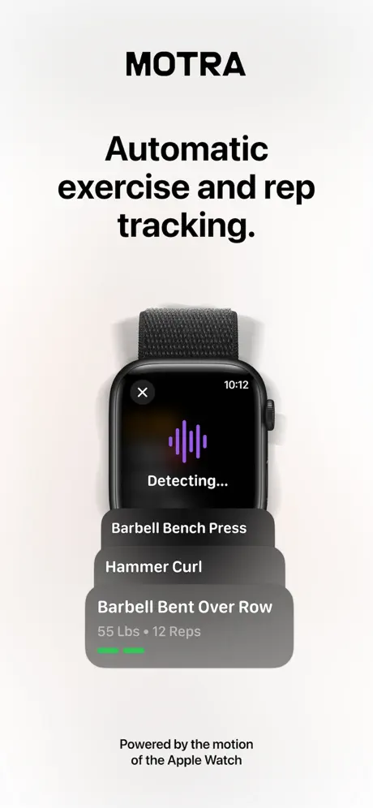
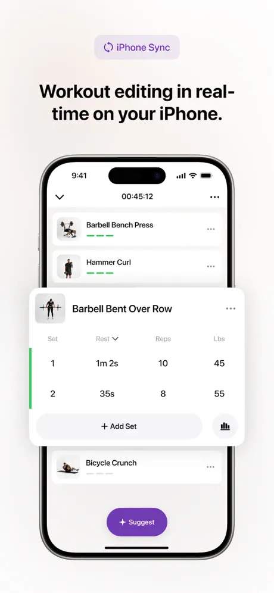
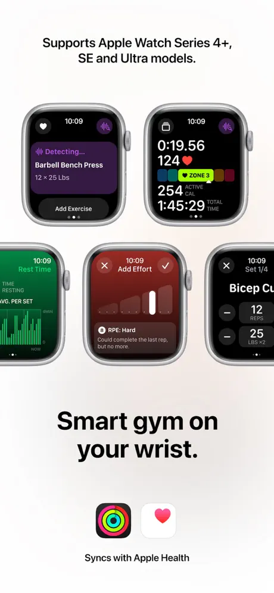
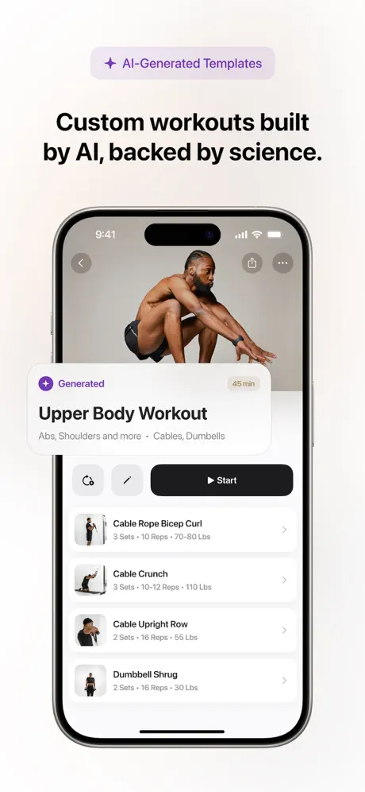
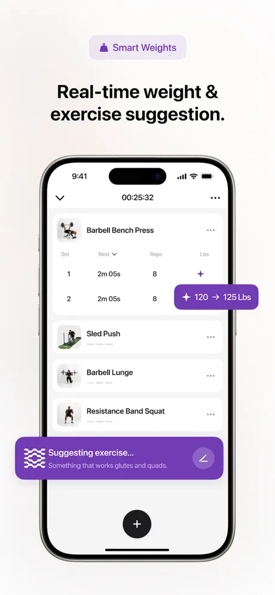
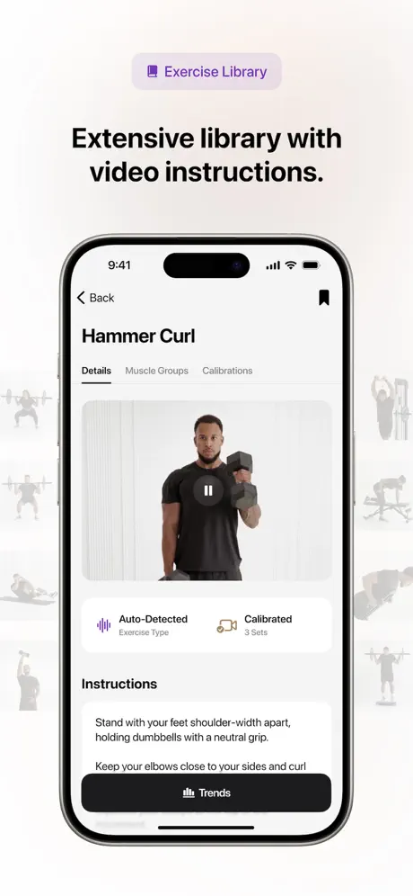
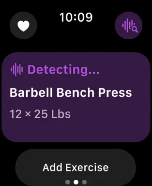
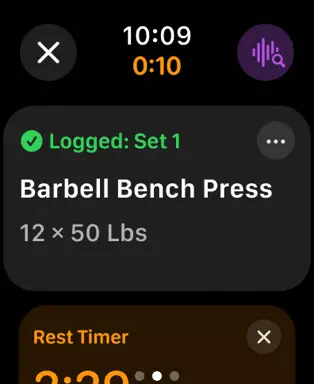
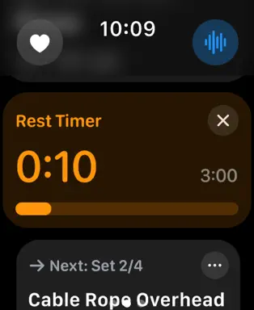
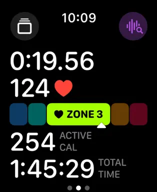

# Motra 측정 UI·운동 절차 연구

연구 자료 수집과 비교만 진행. 워치짐 앱 코드·디자인·세트 절차는 변경하지 않음.

Motra 공식 미국 App Store 홍보 이미지 10장, 공식 웹사이트와 도움말을 읽고 워치짐 현재 소스와 비교했다. Motra 앱을 설치하거나 실제 운동으로 검증하지 않았다. 공식 이미지도 편집된 홍보 화면이며 실제 조작 횟수의 증거는 아니다.

## 수집 이미지

### phone-1: 자동 기록의 홍보 메시지

손목 감지와 운동 기록이 쌓이는 모습을 강조한다. 실제 폰 측정 화면 전체를 보여주는 이미지는 아니다.

검토 후보: 브랜드가 약속하는 경험을 파악하는 자료다. 여기서 실시간 정확도나 모든 조작의 부재를 추정하지 않는다.

### phone-2: 폰에서 기록 편집

운동 썸네일과 이름을 작게 묶고, 펼쳐진 운동의 세트·휴식·횟수·중량을 표로 보여준다.

검토 후보: 현재 운동과 주변 운동을 함께 파악하는 정보 구조, 기록 수정의 위치를 비교한다. 배경색과 목록 구조를 그대로 옮기기로 한 것은 아니다.

### phone-3: 워치 화면의 역할 분리

감지·통계·운동 강도 입력·세트 편집 등 여러 워치 화면을 함께 소개한다.

검토 후보: 한 화면에 모든 기능을 넣지 않는 구조를 참고한다. 홍보에 함께 배치된 순서를 실제 화면 전환 순서로 단정하지 않는다.

### phone-4: 운동 전 루틴 선택

루틴 설명과 운동 목록, 시작 동작을 보여준다. 운동 전 계획 화면이다.

검토 후보: 운동 전 확인과 운동 중 기록의 역할을 구별한다. 큰 안내 이미지를 모든 측정 화면에서 없애야 한다는 근거는 아니다.

### phone-5: 중량·운동 추천

기록 표 위에 중량 변경과 운동 추천을 강조하는 홍보 요소가 올라와 있다.

검토 후보: 추천과 실제 측정을 구분해 읽어야 한다. 팝업을 그대로 채택하거나 중량을 센서로 측정한다고 설명하지 않는다.

### phone-6: 운동 설명과 보정 상태

운동 설명 화면에 시범 영상과 자동 인식·보정 관련 정보를 배치한다.

검토 후보: 설명은 필요할 때 찾아볼 수 있게 하는 참고 자료다. 영상이나 보정 화면의 실제 조작은 확인하지 않았다.

### watch-1: 측정 후보

보라색 면 안에 감지 중 상태·운동명·횟수와 중량을 묶는다. 아래의 운동 추가와 분리돼 있다.

검토 후보: 우리의 측정 중·기록 확정 전 상태도 서로 구별되는지 살펴볼 참고 자료. 보라색이나 카드 모양 채택을 확정한 것은 아니다.

### watch-2: 기록 완료

같은 운동 블록에 초록 완료 표시와 세트 번호가 나타나고 아래에서 휴식 블록이 이어진다.

검토 후보: 단순히 숫자가 멈춘 상태와 기록이 저장된 상태를 사용자가 구별할 수 있는지 비교한다.

### watch-3: 휴식과 다음 세트

주황색 휴식 시간·목표 시간·진행 막대 아래에 다음 세트 정보가 이어진다.

검토 후보: 시간의 의미, 다음 행동, 닫기 버튼의 필요성을 각각 검토한다. 우리 카운트다운을 경과 시간 방식으로 바꾸기로 한 것은 아니다.

### watch-4: 별도 통계 화면

심박·심박 구간·활동 칼로리·총 운동 시간을 한 화면에 모은다. 측정 후보 화면과 분리돼 있다.

검토 후보: 운동 중 당장 필요한 정보와 쉬는 동안 볼 보조 정보를 나눌 때 참고한다. 지원하지 않는 통계를 채우지 않는다.

## 절차와 미확인 경계

### 빈 운동 (S4)

폰 또는 워치에서 시작 → 지원 운동을 수행 → 감지 결과·세트 확인 → 필요한 값만 수정 → 다음 세트·운동 → 종료·저장

미확인: 자동 저장과 사용자 확인의 정확한 경계, 확인을 요구하는 빈도, 전체 탭 수는 직접 조작 전 미확인.

### 루틴 운동 (S4, S7, S11)

루틴 선택 → 운동 시작 → 가이드 모드 선택 가능 → 수행·기록·필요시 수정 → 휴식·다음 세트 → 종료·템플릿 반영 선택

미확인: 가이드 모드 상세 링크가 현재 없는 페이지로 연결돼 안내 방식·전환 제스처는 확인하지 못했다.

### 한쪽씩 수행 (S6)

한쪽 10회 → 반대쪽 10회 → 기록상 10회 · x2

미확인: 기록 규칙만 확인됐다. 반대쪽 시작·종료 감지, 교대 패턴, 각 팔의 다른 횟수, 휴식 시작 조건은 미확인.

## 워치짐과 비교 — 변경 결정 아님

| 항목 | Motra | 워치짐 현재 소스 | 검토 후보 |
|---|---|---|---|
| 운동 중 정보 위계 | 워치에서 감지 후보·완료·휴식을 다른 상태 블록으로 보여준다. | 횟수 48sp와 목표 14sp로 이미 크기를 구분한다. 휴식 때 숫자도 남은 시간으로 바뀐다. | 단순히 숫자를 키우기보다 측정값·저장 완료·연결 상태가 구별되는지 검토한다. |
| 폰의 화면 공간 | 폰 편집 홍보 화면은 작은 운동 썸네일·이름과 세트 표를 중심으로 구성한다. | 현재 운동 이미지 영역은 평소 190dp, 입력 중 92dp이며 라이브 정보는 높이 60dp의 12sp 두 줄이다. | 이미지·세트 표·라이브 정보의 공간 배분을 비교한다. 큰 이미지를 삭제하거나 폰 전체를 목록으로 바꾸기로 결정하지 않는다. |
| 완료·수정의 접근 | 감지 중 화면과 기록 완료 화면이 다르며 수정 진입점이 보인다. 정확한 확인 절차는 미확인이다. | 워치 첫 화면은 횟수 중심이고 세트 완료·횟수 수정은 아래 제어 페이지에 있다. | 필요한 시점에 완료·수정으로 쉽게 갈 수 있는지 비교한다. 첫 화면에 버튼을 반드시 추가한다는 결정은 보류한다. |
| 휴식의 의미 | 기본은 세트 종료 이후 경과 시간이며 별도로 목표 알림을 둔다. | 현재는 남은 시간 카운트다운이며 폰에 조절·일시정지·건너뛰기 동작이 있다. 펼친 휴식 화면은 사용자가 연다. | 시간의 의미를 명확히 설명하고 다음 세트 준비를 함께 보여줄 필요를 검토한다. 이미 있는 수동 펼치기를 자동 팝업 결함처럼 취급하지 않는다. |
| 한손·양손·교대 | x2와 한쪽 기준 입력으로 기록 규칙을 단순화한다. 수행 방식 선택 UI는 공개 자료에서 확인 못 했다. | 현재 좌우·교대에 따른 세트 종료와 휴식 시작을 별도 처리하지 않는다. 앞선 대화의 모드 선택은 아직 제안이다. | 각 팔 기준 표시·평소 선택 없음·팔 전환 조작 없음이라는 목표를 검토한다. 마지막 한 번의 완료와 자동 감지 중 어떤 절차가 맞는지는 별도 연구한다. |
| 반복 입력 줄이기 | 지난 값 재사용, 이후 미완료 세트 자동 갱신, 다음 루틴 반영을 서로 구분한다. | 기존 키패드에 전체 적용 기능과 루틴 영구 저장이 이미 있다. | 매 세트·매 운동 종료마다 적용 범위를 묻지 않으면서 일시 변경과 루틴 기본값을 구별하는 방법을 비교한다. |
| 작은 워치의 조작 | 공식 안내에도 작은 체크 아이콘의 터치 영역 문제 사례가 있다. | 둥근 Galaxy Watch 화면이며 Apple Watch의 직사각형과 배치 제약이 다르다. | 기능 버튼을 늘리기 전에 원형 화면의 잘림·긴 운동명·조작 영역을 검토한다. 직사각형 카드를 단순 축소 복제하지 않는다. |

## 더 확인할 점

- Motra는 한쪽씩 운동할 때 착용 팔 종료와 전체 세트 종료를 어떻게 구분하는가?
- 교대 컬에서 반대팔의 마지막 반복 전 휴식이 시작되는가? 좌우 횟수 차이는 어떻게 수정하는가?
- 감지 중·기록 완료 사이에 사용자 확인이 언제, 얼마나 자주 필요한가?
- 잘못 인식한 운동이나 나뉜 세트를 워치에서 수정하는 실제 조작 수는 몇 번인가?
- 공개 자료의 x2가 각 팔 횟수와 한쪽 중량에 각각 어떻게 표시되는가?
- 가이드 모드가 안내만 하는지, 다음 세트 시작·휴식 전환까지 제어하는지? 상세 문서가 현재 없다.
- 이번에 별도로 조사 중인 불만 리뷰 200개가 도착하면 어떤 문제가 반복되는가? 아직 그 파일을 받거나 분석하지 않았다.
- 워치짐에서 이미지·라이브 정보·세트 표의 우선순위를 어떻게 나눌지? 현재 화면을 보며 결정하기 전이다.

이 자료를 함께 보고 가져올 정보 구조·진행 절차를 고른 뒤 필요한 화면만 시안을 만든다. 구현과 배포는 이번 연구 범위가 아니다.

## 출처

- [S1 · 공식 웹사이트](https://www.motra.com/) — 확인일 2026-10-16. 손목 움직임을 이용한 운동 자동 인식·반복 기록과 상호작용 최소화를 내세운다. 470개 이상 지원과 정확도 관련 문구는 업체 주장으로 취급한다.
- [S2 · 미국 App Store · 폰 홍보 이미지](https://apps.apple.com/us/app/motra-ai-workout-fitness-coach/id1548577496) — 확인일 2026-10-16. 현재 공개된 폰 홍보 이미지 6장을 수집했다. 폰 편집 화면과 워치 화면을 합성해 소개하는 이미지가 섞여 있다.
- [S3 · 미국 App Store · 워치 화면](https://apps.apple.com/us/app/motra-ai-workout-fitness-coach/id1548577496?platform=watch) — 확인일 2026-10-16. 감지 중, 기록 완료, 휴식, 통계 화면 4장을 수집했다. 직사각형 Apple Watch 화면이며 Galaxy Watch의 원형 화면과 공간 조건이 다르다.
- [S4 · 시작·운동·종료 흐름](https://help.motra.com/en/articles/9980535-getting-started-with-motra) — 문서 표기 2026-03-19. 빈 운동은 폰 또는 워치에서 시작한다. 감지 후 세트를 확인하고 필요하면 중량을 수정한다. 미지원 운동은 직접 추가한다. 루틴 운동에는 가이드 모드가 소개돼 있고, 종료 뒤 템플릿 갱신을 선택할 수 있다. 기본 감지 최소 반복은 3회라고 안내한다.
- [S5 · 중량 입력·지난 값·x2](https://help.motra.com/en/articles/9672229-weight-input) — 문서 표기 2026-03-19. 중량 입력은 수동이라고 명시한다. 지난 값을 기억하고 이전 기록 열이나 템플릿 갱신으로 다시 쓸 수 있다. x2 운동은 한쪽 중량을 입력한다. 입문 문서의 자동 중량 표현을 실제 센서 중량 측정으로 읽으면 안 된다.
- [S6 · 반복 횟수와 한쪽 운동](https://help.motra.com/en/articles/9696458-counting-reps) — 문서 표기 2025-12-18. 한쪽 운동은 한쪽 기준 횟수로 기록한다. 왼쪽 10회 뒤 오른쪽 10회는 20회가 아닌 10회이며 x2 표시로 구분한다. 반대팔 수행을 자동 검증하는 방식, 좌우 차이 처리, 한쪽씩과 교대를 고르는 UI는 설명하지 않는다.
- [S7 · 휴식 경과 시간과 알림](https://help.motra.com/en/articles/9671219-rest-time-and-rest-alarm) — 문서 표기 2025-12-20. 마지막 세트 종료 이후 경과 시간을 세고 목표 시점에 알린다. 폰·워치·Live Activity에 표시한다. 루틴의 세트별 목표 휴식을 사용할 수 있다. 수동 운동은 세트 입력 시점·운동 종류·횟수로 휴식 시작을 추정한다고 명시한다.
- [S8 · 워치 표시 항목](https://help.motra.com/en/articles/9911165-customizing-apple-watch-display) — 문서 표기 2025-12-18. 운동 중 설정에서 표시 항목을 바꾼다. 휴식 항목은 고정이고 나머지 통계 슬롯을 선택할 수 있다. 슬롯 수 관련 설명은 문장만으로 재구성하지 않고 실제 설정 확인 전으로 둔다.
- [S9 · 폰 세트 수정의 적용 범위](https://help.motra.com/en/articles/11081434-updating-set-weight-reps-and-rest-time) — 문서 표기 2025-12-22. 한 세트·전체 세트·자동 갱신을 구분한다. 자동 갱신은 수정한 차이를 이후 미완료 세트에 전달하고, 완료된 세트는 건드리지 않는다고 설명한다. 이를 수행 방식 선택의 동작으로 확대 해석하지 않는다.
- [S10 · 워치와 폰의 자동 갱신 차이](https://help.motra.com/en/articles/12676559-smart-set-updates-auto-update) — 문서 표기 2025-12-20. 폰은 키보드 위에서 자동 갱신을 선택할 수 있다. 워치는 기본 꺼짐이며 폰 설정에서 전체적으로 켠다. 워치에서 매 세트 켜고 끄는 방식은 제공하지 않는다고 명시한다.
- [S11 · 운동 후 템플릿 갱신](https://help.motra.com/en/articles/9696236-update-template) — 문서 표기 2024-10-25. 운동 구조·횟수·중량·휴식의 템플릿 반영을 구분한다. 폰은 종료 시트의 설정, 워치는 저장 화면의 템플릿 갱신 배너에서 범위를 정한다고 안내한다. 이 설명만으로 매 종료 때 질문이 강제된다고 단정할 수 없다.
- [S12 · 슈퍼세트](https://help.motra.com/en/articles/9672557-supersets) — 문서 표기 2025-12-20. A-B-A-B의 반복 패턴으로 슈퍼세트를 감지하거나 직접 그룹으로 묶는 흐름을 소개한다. 두 운동의 번갈아 수행과 한 운동의 좌우 교대는 다른 개념이다.
- [S13 · 공식 문제 해결 안내의 조작 이슈](https://help.motra.com/en/articles/14021529-troubleshooting-apple-watch-connection-issues) — 문서 표기 2026-08-10. 일부 워치 화면에서 확인 아이콘의 터치 영역이 작아 다른 화면이 열릴 수 있는 문제를 안내한다. 연결 상태, 동기화 재저장 경로도 설명한다. 공식 안내의 존재와 현재 버전에서의 직접 재현 여부는 구분한다.

관련 문서: [한손·교대 조작 부담 조사](../../docs/research/2026-10-16-unilateral-interaction-research.md), [이전 워치 UX 조사](../../docs/WATCH_UX_RESEARCH_2026-10-15.md).

## 오늘 데스크탑 스크린샷 추가 관찰

홈페이지 홍보 연출과 App Store 공개 화면을 별도 참고군으로 구분한다. 실제 앱에서 언제 탭해야 하는지, 무엇이 자동으로 전환되는지는 정지 이미지로 확인할 수 없다.

| 촬영 시각 | 상태 | 직접 확인 | 해석과 한계 |
|---|---|---|---|
| 13:40:47 | 감지 중 | 파란 큰 숫자 6, Bicep Curl, Detecting, Tap to Continue 안내 | 측정값과 운동명이 중심이다. 계속하려면 탭하라는 안내가 있지만, 실제로 언제 탭이 필수인지 알 수 없다. |
| 13:41:05 | 완료 피드백 | 큰 초록 체크, Bicep Curl, 6 Reps · 40 Lbs | 완료 순간에는 숫자 대신 체크가 주 정보가 된다. 탭 전후인지 자동 전환인지 정지 이미지로 확인할 수 없다. |
| 13:41:12 | 휴식·직전 기록 | 주황 시간 0:01, 심박 124, 아래 Logged: Set 1 · Bicep Curl · 6 × 40 LBS | 시간·심박이 위, 방금 한 세트는 아래의 작은 블록이다. 위쪽 타이머 아이콘이 두 상태를 구별하는 단서다. |
| 13:41:20 | 다음 세트 안내 | 주황 Start!, 심박 124, 아래 Up Next: Set 2 · Bicep Curl · 12 × 30 LBS | 전체 배치가 비슷한 채 직전 기록이 다음 목표로 바뀐다. Start!는 여기서 문구이며 실제 시작 버튼이라고 확정할 수 없다. |
| 13:41:38 | 보조 통계·착용 예시 | 실제 착용을 연출한 홍보 이미지에 시간 1:03, 심박 124, 총 칼로리 236, 심박 구간 표시 | 기본 측정과 통계 화면의 역할을 나눌 참고 자료다. 왼쪽 기능 소개 문구로 실제 손목 감지 정확도를 입증하지 않는다. |

- 우리도 측정·완료·휴식·다음 준비에서 무엇을 가장 크게 보여줄지 상태별로 비교한다. 숫자를 일괄적으로 키우거나 카드를 일괄 추가하는 결론은 아니다.
- 직전 기록과 다음 목표를 같은 위치에서 바꾸는 구성이 사용자의 시선 이동을 줄이는지 검토한다.
- 홈페이지 큰 숫자 중심 화면과 App Store 카드 중심 화면을 별도 참고군으로 두고, 어느 쪽에서 무엇을 가져올지 사용자와 정한다.
- 색은 측정·완료·휴식 상태를 구별하는 역할로 연구한다. 보라색·파란색·초록색을 그대로 채택하지 않는다.
- 일방 동작 종료, 전체 세트 완료, 저장 확정, 다음 세트 안내를 같은 사건처럼 처리하지 않는다. 정지 이미지로 자동 전환 여부를 결정하지 않는다.

## 디자인 스타일과 화면 전환 추가 연구

사용자 스크린샷 5장, 공식 스토어 이미지 10장, 홈페이지의 실제 스크롤 반응과 공개 워치 렌더 시퀀스 중 11개 프레임을 확인했다. 홈페이지 홍보 연출, 스토어 이미지, 실제 앱 동작을 별개로 취급한다.

### 배경과 면

관찰: 홈페이지 워치 연출은 검정 바탕에 콘텐츠를 직접 놓고, 직전 기록·다음 목표를 담을 때 아래쪽 회색 면 하나를 쓴다. 스토어 워치 화면은 보라색 감지 카드 등 더 조밀한 구성이며, 폰 편집 화면은 밝은 바탕이다.

해석: 카드 자체가 정체성이라기보다, 지금 집중할 정보와 묶어 읽을 정보를 다르게 표현한다.

검토 후보: 우리의 모든 화면을 카드형·밝은 테마로 바꾸지 않고 측정값·세트 요약을 어떤 면에 묶을지 비교한다.

### 글자와 숫자의 성격

관찰: 웹 제목은 현재 데스크톱 CSS에서 Inter 700이며 대표 제목 84px, 기능 제목 60px다. 워치 연출은 웹 제목처럼 두껍지 않은 큰 숫자, 그보다 작은 운동명, 더 작고 흐린 단위·보조 설명을 쓴다. 워치의 정확한 서체는 이미지로 확인할 수 없다.

해석: 단순한 크기 차이 외에 굵기·명도·단위 분리로 읽는 순서를 만든다. 웹 제목의 글꼴·크기를 워치 UI 규격으로 옮기면 안 된다.

검토 후보: 한국어 운동명 길이와 숫자 1~3자리에서 크기·굵기·행간을 함께 비교한다. 지금 있는 큰 횟수를 더 키우는 것으로 연구를 끝내지 않는다.

### 색의 역할

관찰: 홈페이지 연출에서 측정은 파랑, 완료는 초록, 휴식·다음 시작 안내는 주황이다. 운동명과 수치는 주로 흰색·회색이며 심박 아이콘은 별도 빨강이다. 스토어 감지 카드에는 보라색도 있다.

해석: 강조색이 장식이 아니라 상태와 정보 종류를 구별한다. 하지만 공개 이미지마다 역할과 배치가 달라 하나의 확정 팔레트로 합치면 안 된다.

검토 후보: 워치짐의 민트를 유지할지와 별개로 준비·측정·저장·휴식·오류가 같은 강조로 읽히는지 비교한다. 색만으로 구별하지 않고 짧은 문구·기호도 함께 본다.

### 여백과 정렬

관찰: 측정·완료 연출은 가운데 정렬과 넓은 빈 공간을 쓰지만, 휴식·통계는 왼쪽 기준으로 숫자·단위·정보 블록을 쌓는다. 상단 시계·원형 아이콘 줄은 화면 가장자리와 거리를 둔다.

해석: 한 가지 큰 값을 읽는 장면과 여러 값을 비교하는 장면의 정렬 방식이 다르다.

검토 후보: 우리 원형 워치에서 가장자리 잘림, 긴 운동명, 버튼 영역을 먼저 확보하고 정렬을 고른다. 직사각형 Apple Watch 화면을 비례 축소하지 않는다.

### 형태와 터치 요소

관찰: 상단의 보조 동작은 원형 바탕의 작은 아이콘, 기록은 모서리가 둥근 넓은 회색 면, 중요한 숫자는 테두리 없는 텍스트로 표현한다. 정확한 반경·터치 크기는 홍보 이미지로 알 수 없다.

해석: 모든 것을 같은 둥근 버튼이나 같은 크기의 카드로 만들지 않는다. 단, 예쁘게 보이는 아이콘이 실제로 누르기 편하다는 증거는 아니다.

검토 후보: 한손 조작과 땀난 손에서 동작을 찾고 누르기 쉬운지 확인할 항목으로 둔다. Motra 공식 도움말의 작은 체크 터치 영역 문제도 함께 고려한다.

### 깊이·반사·제품 연출

관찰: 워치 몸체는 입체 회전과 유리 반사·빛 번짐을 포함한 미리 렌더된 제품 이미지다. 이런 효과는 UI 위에 반사처럼 겹쳐 보인다.

해석: 홍보용 렌더의 조명·반사와 실제 앱의 배경 효과를 구별해야 한다.

검토 후보: 우리 측정 화면에 유리 효과·글로우·장식 그라데이션을 추가할 근거로 쓰지 않는다.

### 웹 기능 소개 전환

관찰: 스크롤을 내리면 워치 제품 렌더 프레임이 진행된다. 웹 제목의 부모 요소는 사라질 때 opacity 0과 y=-50px, 들어오기 전 opacity 0과 y=+50px를 보였고 활성 구간에서는 1과 0 부근이 된다.

분석: 웹 홍보 문구는 세로 이동과 페이드의 조합, 제품은 스크롤에 따른 이미지 시퀀스다.

한계: 실제 앱 화면의 슬라이드나 3D 전환이 아니다. 고정 시간 애니메이션의 길이·이징을 이 관찰만으로 단정하지 않는다.

### 측정 숫자의 변화

관찰: 프레임 19에는 파란 4와 5가 숫자 자리 위아래에 동시에 보인다. 운동명과 계속 안내는 그 아래에 남아 있다.

분석: 숫자 영역 안에서 세로로 교체되는 중간 모습을 확인할 수 있다. 횟수 변화와 화면 전체의 전환은 다른 크기의 움직임으로 구분해서 본다.

한계: 홍보 렌더의 숫자 교체이며 실제 앱의 구현 시간·이징을 확인한 것은 아니다. 우리 폰에도 이미 숫자 롤링이 있으므로 새 기능처럼 중복 제안하지 않는다.

### 측정에서 완료 피드백

관찰: 프레임 41은 희미한 초록 원호, 45는 거의 완성된 원과 체크, 49는 정착된 완료 기호다. 아래 운동명과 결과가 유지된다.

분석: 완료를 단순한 글자 교체가 아니라 원호·체크의 완성과 잠깐의 강조로 표현한다. 45와 49 사이 기호 크기도 약간 달라 보인다.

한계: 실제 앱의 체크 애니메이션 시간·스프링·진동·저장 성공 시점은 확인하지 않았다. 픽셀 관찰을 구현 파라미터로 바꾸지 않는다.

### 완료에서 휴식

관찰: 프레임 49의 가운데 완료 레이아웃과 55의 휴식 레이아웃 사이, 51·53에는 두 화면의 시계·운동명·숫자가 서로 다른 위치에 겹쳐 보인다.

분석: 홈페이지 렌더에서는 기존 화면이 흐려지고 다음 화면이 나타나는 크로스페이드가 확인된다. 동일한 텍스트 객체가 이동하는 공유 요소 전환이라고 입증되지는 않는다.

한계: 실제 앱의 화면 교체 방식이나 자동 세트 종료 절차로 간주하지 않는다. 겹친 글자는 중간 프레임의 홍보 연출이지 실제 앱 오류라고 할 수 없다.

### 휴식에서 다음 준비

관찰: 프레임 55→60→65에서 같은 시간 위치가 0:03→0:01→0:00으로 바뀌고, 70에는 그 자리에 Start!가 나타난다. 아래 회색 면도 직전 세트 기록에서 다음 세트 목표로 바뀐다. 심박과 시계의 큰 배치는 유지된다.

분석: 이미 익숙한 영역의 내용을 바꿔 다음 행동을 알린다. 이 홍보 시퀀스에는 카운트다운 표현이 있다.

한계: 공식 도움말의 기본 휴식 경과 시간 설명과 구별해 기록한다. 목표 알림 예시일 가능성은 있지만 확인 전 추정이다. Start!가 탭 버튼인지, 글자가 어떤 보간으로 바뀌는지는 미확인이다.

- 우리 폰 코드에도 숫자 롤링, 체크 그리기, 화면 전환이 이미 있다. Motion.kt의 180ms 숫자·200ms 작은 변화·300ms 패널/페이지, WorkoutParts.kt의 260ms 체크가 확인된다. 애니메이션 유무가 아니라 언제 어떤 변화를 쓰는지 비교할 문제다.
- 기록 저장 전 완료 연출을 먼저 보여주거나, 휴식 종료 안내를 다음 세트가 이미 시작된 것처럼 보여주지 않는 것이 구현 전 연구 조건이다.
- 웹·워치·폰을 같은 디자인 스킨으로 일괄 변경하지 않는다. 홈페이지 숫자 중심 워치 연출, 스토어 카드 중심 워치 화면, 폰 편집 표를 별도 참고군으로 비교한다.

다음은 색·타이포·면·정렬·여백·전환별로 무엇을 참고할지 고르는 단계다. 이 자료 자체가 신규 UI 시안이나 구현 승인안은 아니다.
