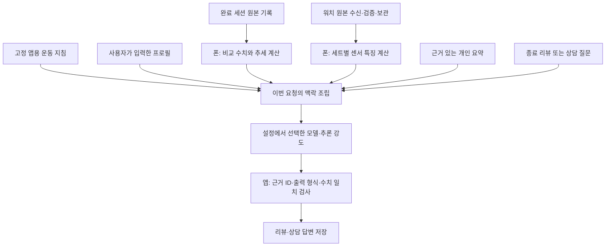
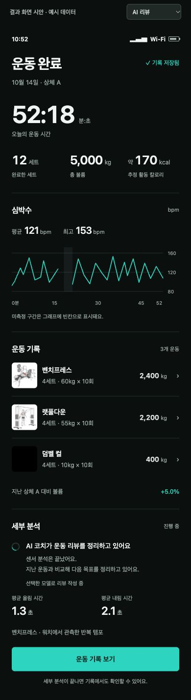
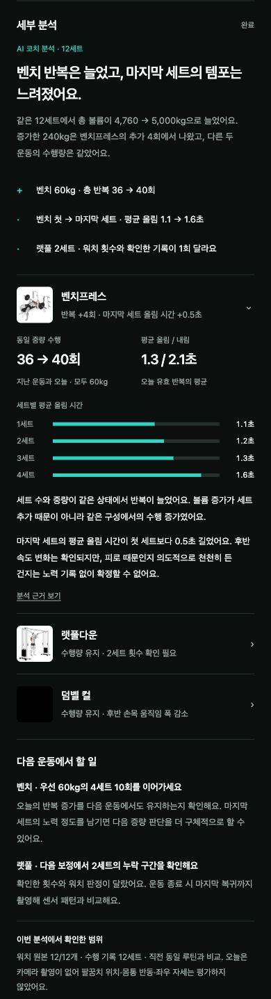

# 앱 내부 GPT 적용 계획 — 개인 보정·운동 리뷰·상담

2026-10-13 작성 / 2026-10-14 확장. 사용자 요청에 따른 설계와 프롬프트 초안이다.
기존 리뷰·상담 계획에 운동별 촬영 안내, GPT 보정 워커와 사용자 엔진 최적화를 추가했다.
현재 진행 중인 측정 개편을 먼저 마무리한 뒤 이 계획의 GPT 통합을 후속 작업으로 진행한다.
문서 갱신은 기능 구현·작업 예약·실제 계정 추론 성공을 뜻하지 않는다.
상담 버튼, 신체 프로필 입력 화면, GPT 개인 보정, 종료 후 AI 분석은 아직 구현하지 않았다.
공통 Responses 실행기와 계정별 프로필·대화 저장/근거 조립의 기초 코드를 추가했다.
현재 화면에서 AI 작업을 실행하는 연결은 없으며 실제 계정 추론 성공을 뜻하지 않는다.
현재 로그인·모델/추론 강도 설정은 있으나 실제 계정 호출은 검증하지 않았다.

## GPT를 적용할 부분

| 작업 | GPT의 역할 | 앱이 계산·검증·저장하는 것 |
|---|---|---|
| 개인 운동 보정 | 동기화된 관절·센서 특징의 불일치 해석, 허용된 엔진 매개변수·후보 선택 제안 | 시간 정렬, 수치 오차, 원본 재생, 독립 검증, 프로필 버전·워치 적용 |
| 운동 종료 리뷰 | 점진적 과부하와 측정 결과 해석, 다음 목표 제안 | 동일 조건 기록 비교·수치·근거 ID |
| 운동 상담 | 입력 프로필·운동 이력·검증된 측정 결과를 조회해 답변 | 읽기 범위, 대화 저장, 기록 소유권·근거 확인 |
| 측정 결과 설명 | 관측 가능한 템포·움직임 변화와 측정 실패 원인을 짧게 설명 | 실제 관측 범위, 가림·공백·불확실성 표시 |
| 장기 개인 요약 | 여러 기록에서 변화·선호·다음 운동 제안을 정리 | 사실/해석 구분, 원본 revision 변경 시 갱신 |

모든 작업은 같은 계정 연결과 공통 실행기를 사용한다. 보정은 독립 task로 분리하며 상담 답변이
엔진 설정을 바로 변경하는 경로를 만들지 않는다. 각 작업의 활성화와 자동 실행 여부는 앱 설정에 저장한다.

## 사용자 흐름

1. 메뉴 오른쪽 위 설정에서 ChatGPT 연결, 사용할 모델·추론 강도를 선택한다.
2. 내 운동 프로필에 신체 정보·목표·운동 경력·제약을 직접 입력하고 저장한다.
3. 운동 종료 즉시 시간·완료 세트·총 볼륨·추정 활동 칼로리·심박 그래프·운동별 기록을 표시한다.
4. 하단 세부 분석 영역에서 워치 원본 수신·속도/움직임 분석·선택 모델의 AI 리뷰를 이어서 표시한다.
   전체 센서나 GPT 응답을 기다리지 않고 종료 요약을 먼저 연다.
5. 메뉴의 작은 `운동 상담` 버튼으로 채팅을 연다. 계정·모델 설정을 공유하며 필요한 기록을 조회한다.
6. `측정·보정 → 내 측정 엔진`에서 새 촬영 자료로 GPT 보정 도움을 요청하고,
   비교 결과·검증 대기·적용된 버전과 이전 버전으로 되돌리기를 확인한다.

자동 리뷰는 설정에서 켜고 끌 수 있게 한다. 활성화되어 있고 계정·한도 사용 동의·모델 선택이
유효할 때만 종료 후 호출한다. 연결하지 않았거나 호출 실패 시에도 운동 기록과 수치 비교는 제공한다.
설정 변경만으로 작업을 실행하지 않는다.

## 개인화 구조

스킬 본문을 운동마다 수정하지 않는다. `고정 지침 + 프로필 + 조회한 기록/센서 요약 + 질문`을
조립해 전달한다. APK에 넣은 지침에는 사용자 이름·신체 수치·개인 루틴·개인 통증 이력을 포함하지 않는다.

프로필 기본값은 미입력이다. 키, 체중과 측정일, 선택적 체성분, 목표, 운동 경력,
주요 제약, 가능한 기구/증량 단위 등을 사용자가 입력한다. 모델이 키·체중·질환 등을 추정해서 채우지 않는다.
프로필에는 별도 ID를 두고 AI 연결 계정과 관계를 명시적으로 저장한다.
기존 기록을 어느 프로필에 연결할지 첫 연결 때 확인하며, 계정 변경으로 다른 사람의 정보가 섞이지 않게 한다.

기억은 세 층으로 나눈다.

- 직접 입력한 사실: 신체 정보·목표·선호. 사용자의 수정이 기준이다.
- 기록에서 계산한 사실: 최근 운동별 반복/중량 추세, 빈도, 수신/측정 품질. 원본에서 재생성한다.
- 모델이 제안한 해석: 조언·가설·선호 후보. 근거를 함께 저장하고 개인 사실로 자동 승격하지 않는다.

원본 운동 기록을 요약으로 대체하지 않는다. 요약에는 근거 세션 ID와 기록 revision을 저장하고
횟수 수정·늦은 센서 분석·프로필 변경 시 해당 요약을 다시 만든다.

## 종료 후 비교

화면/계산/로딩 계약은 [운동 종료 결과 명세](WORKOUT_RESULT_UX.md)를 따른다.
즉시 요약과 세부 분석을 분리하고 상태 문구는 실제 원본 수신·수치 분석·GPT 실행을 구분한다.

### 첨부 시안

[운동 결과 화면 시안](mockups/workout-result.html)에서 워치 기록 수신·센서 분석·AI 리뷰·완료·
일부 미수신 상태를 전환해 볼 수 있다. 아래 이미지는 AI 리뷰 중인 390px 화면이다.
숫자는 예시이며 실제 Android 앱 구현 화면이 아니다. 구현 시 결과 명세와 이 시안을 함께 참고한다.

분석 완료 시안은 운동별 변화·세트별 템포·근거 펼침·다음 행동까지 포함한다.
예시 payload를 렌더링한 것이며 실제 구현은 `workout_review` v2의 검증된 모델 응답으로 내용을 채운다.
운동 기록·세부 분석 목록의 제목 왼쪽에는 앱 원본 운동 애니메이션을 표시한다.
없는 운동은 같은 크기의 검은 네모로 남기는 규격을 결과 명세에 추가했다.

### 이전 운동과 비교

비교 기준은 오늘보다 앞선 **동일 routineId의 가장 최근 완료 세션**이다.
같은 날 두 번 운동한 경우 sessionId/startedAtMs로 구분한다. 루틴 이름 변경으로 기준이 바뀌지 않는다.
구성이 달라졌으면 공통 exerciseId를 비교하고 추가·삭제·변형·기구 변경을 따로 표시한다.
기구나 수행 조건이 다른 중량은 같은 조건의 증량으로 취급하지 않는다.

계산은 폰이 한다.

- 완료한 일반 세트의 세트 수, 중량, 반복, 총 반복과 kg×회 훈련량.
- 같은 중량의 반복 변화와, 같은 반복 조건의 중량 변화.
- 웜업을 분리한 일반 세트 비교와 세트 추가/삭제에 의한 훈련량 변화.
- 입력된 RPE 등의 노력 정보. 미입력은 미확인으로 남긴다.
- 비교 가능한 범위와 누락된 조건.

예시: 같은 운동의 일반 세트가 40kg×8/8/8에서 40kg×8/8/9로 바뀌었다면
총 반복 24→25, 훈련량 960→1000kg×회, +40kg×회/+4.17%다.
이는 훈련량 변화이며 근육 성장률이나 전체 측정 정확도 수치가 아니다.
볼륨 증가가 단순한 세트 추가인지 같은 세트에서의 반복 증가인지 구분한다.
이전 기록이 없으면 첫 기준 기록으로 표시한다.

LLM은 검증된 차이를 해석하고 우선 운동 1~2개의 다음 목표를 제안한다.
기존 `NextTargetAdvisor`의 수치 후보도 함께 제공하되 해당 후보의 가정과 증량 단위가 맞는지 확인한다.
제안이 기록이나 계획을 바로 수정하지 않는다.

## 워치 로그의 의미

폰은 실제 캡처한 워치 원본을 세트별로 수신·검증·저장한다. GPT에게 보낸 요약을 원본으로 취급하지 않는다.
세트 식별자와 캡처 목록을 기준으로 기대 원본/수신 원본/미수신/미측정을 구분하는 조회를 추가한다.
원본이 늦게 도착하면 수신 중으로 표시한다. 받은 자료만 분석할 때는 누락을 명시한다.

모델 입력에는 전 세트의 반복 추정, 반복 시간, 손목 신호 크기/각속도, 후반 변화,
신호 품질, 데이터 공백, 실제 적용 감지 설정을 넣는다. 필요한 의심 구간만 추가 조회한다.
전체 100Hz 원본을 매 질문에 반복 첨부하지 않는다.
손목 신호를 관절 가동범위·근육 활성·자세 품질로 해석하지 않는다.
사용자 입력 횟수, 워치 임시 횟수, 폰 추정 횟수는 구분한다.

상담과 종료 리뷰는 센서 보정 task와 별도다. GPT의 보정 관여는 아래 전용 워커를 통해
후보를 만드는 경로로 연결한다. 개인 보정 채택은 별도의 확인 자료와 원본 재생 검증을 통과해야 한다.

## GPT 운동 보정 워커

### 촬영 안내와 준비

운동을 선택하면 카메라 방향·거리·화면에 포함할 관절·시작 자세를 텍스트와 간단한 예시로 안내한다.
워치 착용 손을 기준으로 관측할 팔을 정하고 셀카 미리보기의 좌우 반전과 해부학적 좌우를 구분한다.
다음 표는 사용자 요청에 따른 초기 촬영 규격이며 실제 폰·기구에서 인식 품질을 확인해 확정한다.

| 운동 | 초기 안내 | 확인할 관절과 범위 |
|---|---|---|
| 컬 | 워치를 찬 팔 쪽 측면/사선, 어깨부터 골반까지 | 어깨·팔꿈치·손목, 팔꿈치 굽힘과 몸통 변화 |
| 벤치/인클라인 프레스 | 워치를 찬 팔 쪽 측면/사선, 기구에 팔이 가리지 않는 위치 | 어깨·팔꿈치·손목의 내려감·올라감 |
| 스쿼트 | 측면, 머리부터 발까지 전신 | 골반·무릎·발목, 몸통 기울기와 깊이 |
| 랫풀다운 | 뒤쪽/후면 사선, 양팔과 상체 | 어깨·팔꿈치·손목의 당김·복귀·좌우 변화; 앞뒤 몸통 반동은 측면 관측 필요 |
| 레터럴레이즈 | 정면/사선, 양팔과 골반 | 팔 벌림, 어깨 높이·몸통 변화 |

기본 43종은 기존 측정 레시피를 공유하되 종목별 촬영 안내 ID·필수 관절·평가 가능한 항목을
빠짐없이 매핑한다. 카메라를 손에 들고 운동하지 않도록 고정 배치를 안내한다.
필수 관절 visibility/presence·프레임 범위·시작 자세·워치 연결을 확인한 뒤 촬영을 시작한다.
보이지 않는 부위는 촬영 위치 변경으로 안내하고 해당 자세 지표를 미측정으로 둔다.
약 20초/10회는 빠른 보정 예시이며 운동별 평소 속도로 수집한다. 목표 횟수에서 원본을 끊지 않는다.

### 로그 조립과 빠른 분석

1. MediaPipe 관절 좌표·신뢰도·원래 프레임 시각과 같은 구간의 워치 원본·착용 조건을 보존한다.
   전체 20초를 10~20개 프레임으로 축소해 학습 원본을 대체하지 않는다. 모델 전달용으로는
   반복당 10~20개 대표 시점 등 검증 가능한 압축 규격을 정하고 원본 구간 ID를 함께 보낸다.
2. 기존 시계 매핑으로 정렬한다. 좌표·가속도·각속도는 단위가 다르므로 원시 숫자를 그대로
   상관 비교하지 않는다. 관절 각도/각속도·위상·센서 특징을 공통 시각에서 비교한다.
   반복 시작·전환·복귀와 횟수, 경계 오차, 누락·가림을 코드에서 먼저 산출한다.
3. 앱이 영상 반복 경계를 먼저 제안하고 사용자는 틀린 구간만 수정·확인한다.
   자동 제안과 사람 확인 라벨의 출처를 보존한다. 기존 수동 검토 화면은 오류 수정 경로로 활용한다.
4. 선택한 계정·모델·추론 강도로 `measurement_calibration` task를 한 번 요청한다.
   입력은 운동/관측 조건, 정렬 오차, 확인 상태, 반복별 특징·대표 좌표, 기존/로컬 후보 비교,
   허용 매개변수·단위·범위, 근거 인덱스다. 영상 파일 대신 수치 로그를 보내며
   모델이 필요할 때 읽을 추가 구간도 앱이 미리 제한된 범위에서 조립한다.
5. GPT는 과다/누락 집계와 반복 경계 차이를 해석하고, 호환되는 기존 엔진의 매개변수 변경이나
   비교할 후보를 최대 2개 제안한다. 출력은 짧은 JSON이다. 센서 알고리즘 코드 생성·실행,
   임의 파일 접근, 장시간 조사나 자유로운 agent 반복을 보정 task에 넣지 않는다.
6. 앱이 JSON과 ID·단위·매개변수 범위를 검사하고 후보를 실제 원본으로 재생한다.
   최종 미사용 검증 자료는 GPT의 튜닝 입력에서 제외한다. 모델이 고친 경계는 사람의 확인 전까지
   학습 정답이 아니다. GPT의 확신이나 파형 유사도 하나를 정확도/자세 점수로 저장하지 않는다.

`측정·보정 → 내 측정 엔진`은 동작 그룹별 현재/이전 버전, 사용한 확인 자료 수·날짜,
기존 대비 횟수·경계·반응 지연 비교, GPT 제안 근거, 마지막 실제 워치 적용 상태를 보여준다.
촬영 중 관측된 자세와 워치만으로 관측되는 움직임 지표는 구분한다. 관측할 수 없는 자세를
카메라 보정만으로 워치 단독에서 확정할 수 있다고 표시하지 않는다.

### 저장·누적·적용

- GPT 제안, 로컬 재생 결과, 독립 검증 결과와 실행 스냅샷을 기존 후보 저장/검증/전송 경로에 연결한다.
  별도의 중복 측정 엔진·원본 저장소를 만들지 않는다. 사용자·동작 그룹·손·착용 방향·기기 조건을 유지한다.
- 한 번의 짧은 촬영으로 후보와 분석 결과는 만들 수 있다. 실제 기본 엔진으로 채택하려면 기존
  `MEASUREMENT_REDESIGN_PLAN.md`와 `ReviewedPatternValidation`/`PatternNativeValidation`의
  독립 자료·정확도·경계·지연 기준을 충족한다. GPT 추가를 이유로 이 기준을 낮추지 않는다.
- 확인 자료가 늘면 새 후보를 만들고 이전 활성 버전·로컬 후보와 같은 자료에서 비교한다.
  새 후보가 통과하면 사용자 적용 또는 설정에서 켠 검증 후 자동 적용으로 다음 세트부터 전송한다.
  워치의 실제 사용 ACK까지 확인하며 진행 중 세트의 설정은 고정한다. 성능 악화 시 이전 버전을 유지한다.
- 보정 이력에는 자료/확인 revision, 입력 해시, prompt/schema 버전, 선택 모델/추론 강도,
  제안·검증 결과·후보 해시·적용 상태를 남긴다. 같은 입력의 재요청은 기존 결과를 재사용한다.

### 응답 시간과 대기 경험

초기 제품 목표는 원본 수신·영상 확인이 끝난 뒤 보정 도움 요청부터 제안과 로컬 비교 결과까지
30초 이내다. 모델/네트워크 응답 시간의 보장이 아니며 실기에서 p50/p95를 측정해 검증한다.
45초를 기본 전경 요청 제한으로 두고 초과·취소·불완전 응답은 미적용으로 종료한다.
사용자가 요청한 모델·추론 강도를 임의로 바꾸지 않는다. 속도 목표를 못 맞추는 설정은 이유와
지원되는 더 빠른 선택지를 보여주고 사용자가 선택하게 한다.

계정 확인/입력 조립/모델 응답/로컬 재생/저장을 각각 계측한다. 요청당 모델 호출은 기본 1회이며
반복별 호출과 무한 재시도는 하지 않는다. UI에서는 현재 단계와 취소를 제공하고 운동 화면을 막지 않는다.
장기 독립 검증에 필요한 추가 세트·날짜는 `검증 대기`로 표시하며 5~10분짜리 전경 분석으로 묶지 않는다.
AI 연결 실패나 한도 초과에도 촬영 원본·로컬 후보·현재 적용 설정을 유지한다.

## 상담 챗봇

메뉴 하단에 작은 `운동 상담` 버튼을 두고 별도 채팅 화면을 연다.
현재 모델/추론 강도를 보여주며 대화와 완료 응답을 앱에 저장한다.
고정 스킬과 현재 프로필을 기본으로 붙이고, 질문에 맞는 기록/추세를 먼저 조회한다.

추가 조회가 필요하면 앱이 제공하는 읽기 도구만 사용한다.

- `read_profile`: 현재 프로필의 허용된 항목.
- `read_workouts`: 루틴/운동/날짜 범위로 완료 기록 조회.
- `read_sensor_summary`: 특정 세션·세트의 센서 특징과 수신 상태.

조회 범위·개수·프로필 소유권은 코드가 검증한다. 모델에 임의 파일 경로나 자유로운 앱 수정 권한을 주지 않는다.
루틴 변경·프로필 변경은 답변의 제안으로 보여주고 사용자가 적용한다.
대화가 길어지면 최근 대화와 근거 있는 과거 요약을 조립한다. 모델이 이전 대화를 저절로 기억한다고 가정하지 않는다.

## 현재 코드에서 이어 쓸 부분

- `FinishedWorkoutStore`/`WorkoutSnapshot`: 루틴·운동·세트 종류·완료 반복·출처·RPE·세트 ID를 가진 완료 세션.
- `ExerciseHistory`: 최근 조회용으로 운동당 20개를 유지한다. 장기 분석의 전체 기록으로 대체하지 않는다.
- `SetAnalysisStore`: 세션별 센서 분석과 revision.
- `CaptureInbox`: 검증된 kcs/kcs.gz 원본과 수신 상태.
- `ChatGptAuth.selectedWorkRequestOptions()`: 선택 모델과 reasoning 옵션. 작업 실행 시 유효 계정/토큰도 재확인한다.

전체 완료 세션은 이미 저장돼 있으므로 새 원본 기록 저장소를 중복 생성하지 않는다.
기존 저장소 위에 AI용 읽기 API·근거 인덱스·개인 요약 캐시를 추가한다.

## 프롬프트와 실행 계약

초안은 `docs/ai-coach-drafts/coach-skill.md`, `session-review.prompt.md`, `chat-coach.prompt.md`,
`measurement-calibration.prompt.md`다. 보정 task에는 별도의 센서/관측 지침을 주며
상담용 운동 지침이 모델에게 센서 정답을 확정할 권한을 주지 않는다.
원본 `hypertrophy-coach`의 일반 원칙과 세션 비교 절차를 축약했다.
기존 사용자의 개인정보·전용 우선순위·개인 루틴·통증 정보와 Obsidian 도구 지시는 포함하지 않았다.
이는 앱용 지침 초안이며 아직 APK assets나 실제 요청에 연결되지 않았다.

프롬프트의 `instructions`/developer 입력과 기록 JSON을 분리한다.
운동 메모·프로필 텍스트는 데이터로 취급한다. 원본 기록 ID를 답변 근거에 남긴다.
모델 출력의 형식·근거 ID·비교 수치 일치는 앱이 검사한다. 프롬프트만으로 일관성을 보장하지 않는다.
비교 수치는 가능한 한 앱이 직접 표시하고 모델의 숫자 재계산에 의존하지 않는다.

[SIWC 공식 제한](https://developers.openai.com/siwc/token-sharing-open-source/preview-limitations)에 따라
public Responses API, `store:false`, `stream:true`, 명시적인 input 배열을 사용한다.
HTTP 대화 상태와 기록 조회는 앱이 관리한다. 이 경로의 hosted file search/Code Interpreter에 의존하지 않는다.
공식 preview에서 지원하지 않는 `max_output_tokens`·`background` 필드를 속도 제한에 쓰지 않는다.
출력 길이는 task/schema와 앱 검사로 제한하고 요청 제한은 클라이언트 취소로 처리한다.
선택 모델·계정 경로에서 지원될 때 `text.format`의 strict JSON Schema를 사용하고,
지원되지 않으면 검증된 대체 형식을 명시하거나 해당 작업을 미지원으로 표시한다.
JSON Schema 준수는 수치 판단의 정확성을 보증하지 않으므로 원본 재생 검증을 별도로 수행한다.
`response.completed`까지 받은 결과만 완료 리뷰로 저장한다.
같은 세션·기록 revision·프롬프트 버전의 중복 종료 이벤트로 작업을 중복 등록하지 않는다.
네트워크 단절로 서버 실행 여부가 불명확하면 무한 자동 재시도로 한도를 소모하지 않는다.
실패/한도 초과/로그인 만료를 표시하고 운동 기록은 유지한다.

## 구현 순서와 완료 기준

현재 측정 개편의 완료 정리 뒤 아래 GPT 통합을 시작한다. 현재 골을 이 문서 수정만으로 완료 처리하지 않는다.

1. 기존 로그인·모델 선택을 사용하는 공통 Responses 실행기를 실제 계정으로 확인한다.
   선택 모델/강도 적용, SSE 완료/실패/취소/불완전, 한도 초과와 중복 요청 처리를 검증한다.
2. 운동별 촬영 안내·필수 관절/시작 자세 확인·자동 반복 구간 제안과 압축 입력을 연결한다.
   43종 안내 매핑, 착용 손/셀카 반전, 가림·시간 오차, 원본 보존을 실제 촬영으로 확인한다.
3. GPT 보정 task와 로컬 후보 재생을 연결한다.
   존재하는 근거만 인용, 허용 범위만 제안, 새 자료의 오탐·누락·시간 오차 개선을 검사한다.
   모델 없는 로컬 후보 대비 GPT 관여의 추가 효과도 같은 미사용 자료로 비교한다.
   나쁜/불완전/지연 제안의 미적용과 30초 목표·45초 요청 제한을 실기에서 계측한다.
4. `내 측정 엔진`에 후보 이력·독립 검증·다음 세트 적용·워치 사용 ACK·롤백을 연결한다.
   한 번의 촬영 후보와 검증 통과 활성 설정을 구분하고 다음 날짜에서도 개선되는지 확인한다.
5. 프로필·완료 기록 읽기·동일 루틴 비교·센서 수신 상태 조회.
   첫 기록, 같은 날 두 세션, 웜업, 기구 변경, 수동 수정, 누락 센서의 비교가 정확해야 완료다.
6. 종료 리뷰와 측정 결과 설명.
   즉시 요약·추정 칼로리·심박 그래프·운동별 결과와 후속 분석 상태를 위 결과 명세대로 연결한다.
   `workout_review` v2로 운동별 변화·특정 세트의 템포/움직임·분석 근거·다음 행동을 구조화한다.
   시안 문장의 하드코딩이 아니라 검증된 모델 출력과 앱 계산 수치를 렌더링한다.
   화면 이탈/복구, 부분 결과, 수동 수정 우선, 선택 모델/강도 적용과 완료/실패/취소를 검증한다.
7. 상담 버튼·채팅 저장·읽기 도구.
   실제 앱 데이터에서 필요한 기록을 찾아 답하고 존재하지 않는 기록을 인용하지 않아야 완료다.
8. 근거 기반 개인 요약 갱신.
   새 기록과 수정 내용이 반영되고 오래된 해석이 새 사실을 덮지 않아야 완료다.
9. 실제 폰/워치·실제 로그인 계정으로 보정·종료 리뷰·상담의 전체 흐름을 확인한다.
   빌드·가짜 endpoint 검사만으로 실제 계정 동작이나 운동/센서 정확도를 주장하지 않는다.

공식 요청 계약: [SIWC 모델·추론](https://developers.openai.com/siwc/token-sharing-open-source/models-and-inference),
[preview 제한](https://developers.openai.com/siwc/token-sharing-open-source/preview-limitations),
[Structured Outputs](https://developers.openai.com/api/docs/guides/structured-outputs).
