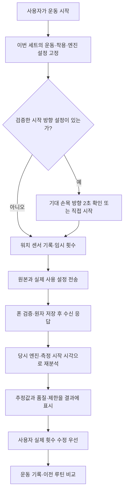

# 운동 측정과 보정 흐름

2026-10-15 현재 소스 기준. 일반 사용자 흐름의 기준 문서다. 소프트웨어 연결과 실제 기기 성공을 구분한다.
승인 기획은 [측정 개편 기획](MEASUREMENT_REDESIGN_PLAN.md), 43종 분류는
[전체 운동 명세](EXERCISE_MEASUREMENT_MATRIX.md), 작업 이력은 [진행 기록](MEASUREMENT_IMPLEMENTATION_PROGRESS.md)을 따른다.

## 폰과 워치가 하는 일

워치는 운동 중 센서를 기록하고 임시 횟수를 센다. 폰은 운동 진행·휴식·기록을 관리하고,
워치 원본을 다시 분석한다. 보정할 때만 폰 카메라를 함께 켜서 사람이 실제 동작을 확인한다.
인터넷이나 AI 로그인은 측정·개인 보정의 필수 조건이 아니다.

- `WearWorkoutService`는 센서·임시 판정·원본을 소유한다. 화면을 보지 않아도 기록을 계속하며
  연결이 끊기면 저장·재전송한다. 물리적 Watch8의 모든 절전/재부팅 상황을 확인한 것은 아니다.
- `PhoneWorkoutService`, `PhoneSessionController`, `SessionStore`가 운동·세트·휴식의 기준 상태를 관리한다.
  루틴 미리보기만으로 운동 타이머를 시작하지 않는다. 워치의 명시적 시작 요청을 저장하고 응답한다.
- `PhoneWearListenerService` → `CaptureInbox`가 해시·파일 크기·샘플 시각 등을 검사해 저장한 뒤 ACK한다.
  폰 분석 실패와 원본 수신 성공은 다르며, 저장 원본으로 분석을 다시 시도할 수 있다.
- 일반 설정과 검증 개인 패턴, 시작 방향, 템포 설정은 세트/시도에 고정한다. 새 보정이나 설정 변경을
  진행 중인 세트에 끼워 넣지 않는다. 폰은 최신 설정 대신 워치가 실제 사용한 스냅샷을 재생한다.
- 수동 정책 7종과 알 수 없는 운동은 자동 측정으로 승격하지 않는다. 실제 횟수를 입력해 완료한다.
  불량/부족 자료·준비만 기록된 자료는 확인 불가이며 실제 0회로 바꾸지 않는다.
- 자이로와 가속도 품질을 따로 검사한다. 가속도 불량·지연·미래 시각을 정상 자이로 값으로 가리지 않는다.
  불량 구간에서 미완성 반복을 끊고, 원본 품질 값은 그대로 보존한다.
- 새 v4 프레스·당김·다축·전완 회전 판정기는 반대 방향의 두 구간과 실제 멈춤/반전을 요구한다.
  같은 방향 두 번을 왕복으로 묶거나, 세트 종료 버튼으로 움직이는 마지막 구간을 완성하지 않는다.
  과거 v3 스냅샷은 당시 종료 규칙으로 명시적으로 재생한다. 버전 변화 자체가 실측 정확도 개선 증거는 아니다.
- `PhoneRepAnalyzer`의 자동 채택 가능한 추정치(`confirmedReps`)는 사람 확인 정답이나 확률이 아니다.
  워치/폰의 횟수가 같아도 실제 횟수와 맞다는 증거는 아니다. 명시적 수동 횟수는 덮어쓰지 않는다.

## 모든 운동에 2초 대기를 요구하지 않는다

시작 방향 후보는 지정 변형의 외회전·리버스플라이·덤벨 레터럴레이즈 3종이다.
33종은 방향 검사 보류, 7종은 수동이다. 자이로만으로 손바닥 위/아래를 확정하지 않는다.
착용 손·위치·워치 본체 방향·기기·운동 변형에 맞는 사람 확인 자료에서 중력 방향 목표를 만든다.

맞는 방향·반대 방향으로 맞춘 후보를 **다른 원본**의 맞는/반대/일상 동작으로 검사한다.
통과한 설정이 있을 때만 기대 손목 방향의 연속 2초를 요구한다. 일상 정지가 구분되지 않으면 통과시키지 않는다.
직접 시작은 미확인으로 남긴다. 준비 원본을 지우지 않고, 실제 판정기에 처음 전달한 센서 시각을 따로 저장한다.
이 검사는 전체 몸의 정자세 판정이 아니다. 상세는 [시작 방향 구현](START_DIRECTION_IMPLEMENTATION.md)을 따른다.

## 개인 보정: 확인한 자료에서 배우고, 별도 자료로 채택한다

1. `측정·보정`에서 운동·착용 조건을 선택해 워치와 폰을 함께 촬영한다.
   43종의 촬영 안내가 있으나 안내 제공이 자동 횟수 지원·성능 인증을 뜻하지 않는다.
2. 폰은 영상 프레임·MediaPipe 관절·워치 원본을 별도 시계 자료로 연결한다. 카메라 추정을 자동 정답으로 쓰지 않는다.
3. 영상에서 시작→전환→복귀를 사람이 확인한다. 잘못된 제안은 경계 수정·제외·분할·합치기한다.
   준비·불완전 반복·멈춤·중량 내려놓기·가림은 별도 제외 구간으로 표시하고 횟수나 학습 정답에 넣지 않는다.
   총 횟수만 입력한 자료에는 반복 경계·위상 정답을 만들지 않는다.
4. `PatternCandidateStore`가 같은 사용자·동작·착용·기기의 확인된 완전 반복 자료에서 개인 패턴 후보를 만든다.
   여러 자료를 누적할 수 있지만 원본 수가 늘었다고 자동으로 정확해지는 것은 아니다.
5. 학습에 쓰지 않은 자료로 기존 엔진과 후보를 비교한다. 워치에서 실제 실행한 출력·원본·사용 설정도 비교하고,
   고정 회귀 자료에서 기존 채택 엔진의 성능이 나빠지지 않는지 확인한다.
6. `PatternAdoptionController`가 채택 직전에 원본·라벨·조건·보고서·활성 설정을 다시 검증한다.
   `PatternTransferOutbox`의 영속 재전송과 정확한 워치 응답을 통해 저장·활성화를 구분한다.
   검증 대기나 실패는 이전 설정을 유지한다. 롤백·기본 측정 복귀도 다음 시도부터 적용한다.

이전 `personalProfile:<exerciseId>` 설정은 호환용으로 남아 있다. 고정 각도 감지기의 시간 기준 등을
조정하는 옛 보정과 새 사람 확인 패턴을 구분한다. 기존 설정을 새 검증 모델로 표시하지 않는다.

영상은 계속 보관하거나 확인 후 영상만 삭제하고 로그를 남길 수 있다. 삭제 전에 원래 영상·프레임 관측 근거를
영속 저장한다. 센서·관절·확인 라벨·기록은 남는다. 실제 영상이 없으면 새 영상 라벨은 만들 수 없다.
선택한 촬영은 영상 포함 여부를 골라 검증 ZIP으로 내보낼 수 있으며 자동 외부 전송하지 않는다.

## 결과와 선택적 AI

폰은 완전 반복의 실제 전환 경계로 반복/힘쓰는/복귀 시간을 표시한다. 방향이나 위상이 확인되지 않으면
세부 시간은 미측정이다. 손목 각속도·회전 움직임 변화와 촬영 중 보이는 관절 편차는 출처·단위를 구분한다.
전신 자세 정확도, 정밀 중량 이동 속도, 근육 활성, 자동 RIR을 측정했다고 표현하지 않는다.

설정의 운동별 템포 알림은 기본 OFF다. 검증 개인 엔진의 완전한 관측 반복에만 적용한다.
연속 이탈·최소 알림 간격을 두고 이번 세트 알림은 워치에서 바로 끈다.
[템포 연결 계약](TEMPO_FEEDBACK_INTEGRATION.md)을 따른다.

사용자가 켠 AI 리뷰·상담은 구조화된 앱 기록과 근거를 읽는 별도 기능이다. 원본 기록·결정적 수치와
모델 해석을 분리하며, AI 보정 제안도 제한된 파라미터/재생/독립 채택 검사를 우회하지 않는다.
[AI 이식 상태](GPT_IMPLEMENTATION_STATUS.md)가 구현 범위의 기준이며 실제 계정 호출은 별도 확인 대상이다.

`측정·보정 → 센서·3D 보기`는 진단 도구다. IMU 적분 궤적을 정밀 손목 위치나 자세 정확도로 표시하지 않는다.
운동·보정 중 동시 센서 사용은 차단한다. 별도 일반 사용자용 실측 모드는 없다.

## 현재 확인되지 않은 것

사용자는 폰 0.7.5에서도 `관절 인식을 시작하지 못했어요`를 보고했다. 내부 예외는 아직 받지 못했다.
관절 인식·영상/워치 동시 촬영이 사용자 폰에서 성공했다고 할 수 없다.
실제 Watch8의 횟수 정확도 향상·시작 방향 분리·템포 진동·지연/전력과 실제 AI 계정 실행도 미확인이다.
대상 단위 검사 통과는 위 기능의 소프트웨어 경로 증거다. 전체 구현 대조 후 마지막 전체 테스트·lint·OTA와
업데이트 배포를 진행하고, 실물 확인 결과를 별도로 기록한다.
