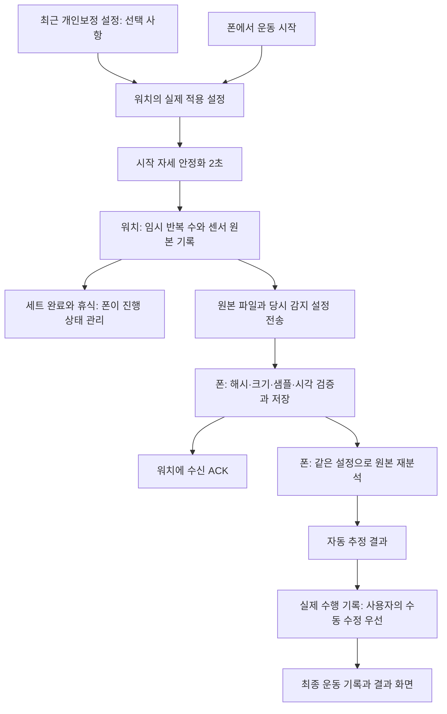

# 운동 측정과 보정 흐름

2026-10-13 현재 코드 기준. 이 문서가 일반 사용자 측정 흐름의 기준이며, 초기 `PLAN.md`의 3D 실측 연구 단계와 구분한다.

## 일반 운동

- 워치 `WearWorkoutService`가 센서/준비 게이트/임시 횟수/원본 캡처를 소유한다. Activity는 표시와 사용자 동작을 맡는다.
- 폰 `PhoneWorkoutService`와 `PhoneSessionController`/`SessionStore`가 운동 시작·휴식·다음 세트·중복 완료 처리의 기준 상태를 소유한다.
- `PhoneWearListenerService` → `CaptureInbox`는 센서 원본을 검증하고 원자 저장한다. 저장된 원본이 있으므로 ACK 후 분석이 실패해도 폰에서 재시도할 수 있다.
- `PhoneRepAnalyzer`는 원본을 다시 읽는 결정적 감지기이며 새로운 AI 판단이나 자동 학습 단계가 아니다. 워치와 같은 설정을 쓰면 횟수가 일치하는 것이 자연스럽다. 일치는 실제 횟수의 정답 증거와 다르다.
- `FinishedWorkoutStore.reconcile`/`WorkoutSessionReducer.confirmReps`는 분석 정책을 통과한 추정치를 기록에 반영하며 명시적 수동 입력을 덮지 않는다. 기존 `confirmedReps` 이름은 알고리즘이 채택 가능한 추정치이지, 사람이 확인한 정답이나 확률이 아니다.
- 새 캡처는 `TrackingProfileSnapshot`을 manifest와 워치 런타임에 남긴다. 그 사이 새로운 개인보정이 저장되더라도 폰은 캡처 당시의 설정으로 재분석한다. 알고리즘 버전/운동별 관측 정책이 맞지 않으면 조용히 최신 설정으로 바꾸지 않고 분석 실패로 원본을 보존한다. 스냅샷이 없는 과거 캡처는 기존 호환 경로를 유지한다.

## 측정·보정: 하나의 사용자 진입점

보정 탭과 메뉴의 `측정·보정` 버튼은 같은 화면을 연다. 기존 메뉴의 `실측 모드`는 별도 일반 사용자 기능에서 제거했다. `ProbeActivity`/`ProbeService`와 `WristTrajectoryTracker`는 이전 센서·3D 궤적 진단 도구로서 코드를 보존했으며, 보정이나 최종 운동 횟수를 만드는 일반 경로에 포함되지 않는다.

메뉴만 합치면서 3D 화면을 열 경로가 끊긴 것을 이후 수정했다. 현재 `측정·보정 → 센서·3D 보기`에서 기존 화면을 열 수 있다. 운동/보정 중에는 다른 센서 세션과 겹치지 않도록 진입을 막는다. 3D 시각화와 원본 CSV 기록은 유지하며, 진단 구간 수를 반으로 나눠 대략적 운동 횟수처럼 보이던 표시는 제거했다. 현재 운동 감지기 검증에는 실제 운동 화면의 워치 횟수와 폰 재분석 결과를 사용한다. 진입/동시 실행 차단 검사와 화면 렌더, 새 폰 OTA 빌드 통과: `work/sensor-view-restored.log`.

현재 보정 흐름은 운동 선택 → 시작 자세 유지 → 왕복 기록 → 폰에서 개인 프로필 생성/저장 → 워치에 전송 요청이다. 시작할 때 기존 개인 프로필로 자기 자신을 다시 보정하지 않고 기본 설정으로 수집한다. 보정 중 일반 운동 시작과 운동 중 보정 시작은 막는다.

## 개인보정이 실제로 하는 일

- 운동별 `personalProfile:<exerciseId>` 하나를 저장한다. 다시 보정하면 교체한다. 여러 세트나 여러 날의 운동 기록을 합치는 누적 학습은 없다.
- 관측한 반복 시간, 움직임 크기, 자이로 축/노이즈 등을 프로필에 저장하고 기본 설정과 혼합해 파라미터를 만든다. 파라미터가 바뀌는 것과 정확도가 높아지는 것은 별개다.
- 현재 굴곡/신전(v4) 시작-복귀 감지기는 개인보정 중 최소 반복 시간만 소비한다. 이탈 60도/복귀 20도는 기본 히스테리시스다. 개인보정의 범위/축/최대 시간은 이 감지기에 적용되지 않는다. UI에서 이 값들이 컬 인식을 학습한다고 설명하지 않는다.
- 다른 동작 계열은 시간·신호 임계값·축 설정 등을 기존 감지기에 반영한다. 손목에서 관측 불가능한 운동의 수동 정책은 보정으로 바뀌지 않는다.
- 보정 때 느리게 움직였다는 이유로 이후 정상적인 빠른 동작을 버리지 않도록 개인 시간 기준이 기본 허용 범위를 좁히지 않게 했다. 정상 10회가 보정 후 0회였던 재현은 수정 후 10회다.

## 확인된 구조적 한계: 아직 구현한 것으로 말하지 않는다

1. 보정 횟수도 같은 감지기가 판정한다. 실제 5회를 사람이 확인하는 독립 정답 라벨/타이밍이 없다. 감지기의 과소·과대 계수가 보정 수집에 영향을 줄 수 있다.
2. 보정 결과를 별도의 정답 세트에서 기본 설정과 비교해 나아졌을 때만 채택하는 검증 단계가 없다. 개인보정이 정확도를 높인다는 실기 근거가 없다.
3. 프로필 전송은 메시지 요청 방식이며 프로필 전용 ACK/내구성 있는 재전송 큐가 없다. 폰에 저장됨과 워치에 적용됨을 동일하게 표시하지 않는다. 새 원본의 설정 스냅샷은 워치가 실제 사용한 설정을 폰이 알게 한다.
4. 일반 운동은 서비스/저장소 기반으로 복구되지만 폰 보정 화면의 진행 상태는 아직 MainActivity 변수다. 보정 중 폰 프로세스 재생성의 사용자 흐름은 일반 운동과 동일한 내구성 계약으로 정리할 필요가 있다.
5. 손·착용 위치·기기/동작 조건별 검증과 장기 누적 데이터의 수용/폐기 정책이 없다. 자료가 쌓이면 자동으로 정확해진다고 표현하지 않는다.

## 검증 기준

운동 횟수 개선을 주장하려면 실제 Watch8에서 사람이 센 정답 횟수와 원본을 남기고, 보정에 사용한 기록과 별도의 검증 기록을 분리한다. 같은 원본에서 기본/개인 설정의 누락·오검출·전체 오차를 비교하고, 새 설정이 나쁠 때 이전 설정을 유지할 수 있어야 한다. 이것이 없는 상태에서는 설정 생성/적용과 재분석 경로의 검증 결과만 보고한다.

## 이번 검진의 검증 결과

- 느린 보정 후 정상 빠른 컬 10회를 0회로 만들던 재현은 수정 후 10회를 유지한다.
- 새 보정 이후에도 이전 캡처의 실제 감지 설정을 유지하는 폰 재분석 검사가 통과했다. 워치의 저장 manifest에도 해당 설정이 포함되는지 확인했다.
- 운동 중 보정 시작이 진행 중 운동 명령을 바꾸지 않는 검사, 스냅샷이 수동 관측 정책을 자동으로 바꾸지 못하는 검사도 통과했다.
- core 140/phone 145/wear 42 = 327건 통과, 실패/오류/건너뜀 0. 공개 데이터 재생 항목도 실행했다. 메뉴·보정 화면을 렌더링해 확인했고 마지막 문구 수정 후 폰·워치 OTA 빌드/lint를 통과했다.
- 공개 배포·기기 설치·과거 원본 일괄 재분석은 하지 않았다. 정확도 향상과 누적 학습은 검증/구현하지 않았다.
- 로그와 소스/APK 해시는 `docs/reviews/2026-10-13-measurement-flow-verification.json`에 기록했다. 이전 측정 수정 완료 검증보다 이후 상태다.
