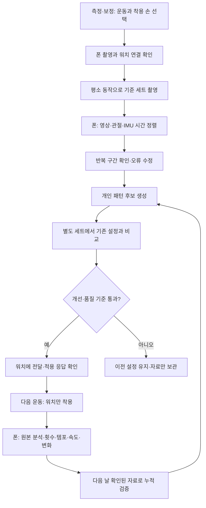

# K코치 측정·개인 보정·운동 피드백 최종 기획안

작성: 2026-10-13 · 기획 버전 1.2 · 기본 43종 전체 명세·수동 흐름·스쿼트/로우/3D 관측 계약 추가

**상태: 사용자 승인 후 단계별 구현·검증 진행 중.**
사용자가 모든 단계를 순서대로 진행한 뒤 GitHub 배포하도록 요청했다.
현재 구현·검증 상태는 [진행 기록](MEASUREMENT_IMPLEMENTATION_PROGRESS.md)을 따른다.
앱의 실제 정확도가 향상됐거나 최적 엔진이 확정됐다는 의미는 아니다.

## 1. 이번 개편의 목표와 범위

워치가 운동 중 반복을 추정하고 원본을 기록한다. 폰은 원본을 더 정밀하게 분석하고,
카메라와 함께 확인한 동작에서 사용자의 패턴을 배운다. 다음 운동은 카메라 없이 워치로
측정하되, 검증된 개인 설정을 사용한다. 결과 화면은 횟수뿐 아니라 템포·속도·움직임 변화의
근거와 측정 가능한 범위를 보여준다.

개편 대상은 횟수 엔진, 개인 보정, 보정 촬영, 반복별 분석과 그 화면이다.
기존 루틴·세트 진행·휴식·기록 저장·센서 원본 전송의 기반을 활용한다.
하단 리퀴드 탭, 현재/휴식 중 세트 강조 등 앞서 정리한 UI를 다시 설계하지 않는다.

측정과 개인화는 폰·워치 내부에서 동작하며 ChatGPT 로그인이나 인터넷을 필수로 요구하지 않는다.
AI 리뷰·운동 상담은 이 측정 결과를 읽는 별도 기능으로 연결한다.

## 2. 공통 동작 그룹과 첫 검증 대상

**운동 이름이나 기구마다 별도 측정 엔진을 만들지 않는다.** 유사한 동작은
동작 그룹의 공통 엔진·반복 정의·위상 분석·카메라 특징 계산을 공유한다.
기존 core의 `MotionFamily` 구조를 출발점으로 사용하되 실제 관측 주기로 그룹을 정리한다.

**전체 분류의 기준은 [43종 전체 운동 명세](EXERCISE_MEASUREMENT_MATRIX.md)다.**
현재 기본 카탈로그의 43개 고유 ID를 11개 자세/위상 레시피에 누락 없이 연결했다.
스쿼트는 추가 G12 레시피이고, 푸시업·하이로우·스탠딩 티바·바벨 숄더프레스는
사용자가 지정한 추가 설계 대상으로 별도 명시했다. 설치 폰의 커스텀 운동은 직접 확인하지 못했다.
아래 대표 표만으로 전체 운동 기획을 대신하지 않는다.

기술 엔진은 T(이동 왕복), A(원호/방향 왕복), R(회전 왕복), M(수동)을 공유한다.
자세 레시피는 시작 자세·한 주기·힘쓰는 방향·관측 관절을 설정한다.
스쿼트와 랫풀은 T를 공유할 수 있지만, 서 있는 자세와 팔을 당기는 자세의 인식 규칙,
내림/당김의 위상 의미를 혼동하지 않는다. 로우의 기구별 투영/지지 조건도 설정으로 처리한다.

| 공통 동작 그룹 | 같은 엔진으로 연결할 운동 예 | 공유할 측정 |
|---|---|---|
| 수직 밀기 | 덤벨 숄더프레스·바벨 숄더프레스·스미스 숄더프레스 | 올림·전환·내림·복귀, 반복/템포 분석 |
| 팔꿈치 굽힘 | 같은 반복 패턴의 덤벨·바벨·케이블 컬 | 굽힘·복귀 주기와 개인 패턴 |
| 팔 벌림 | 덤벨·케이블·머신 레터럴레이즈 | 벌림·복귀 주기와 움직임 변화 |
| 팔꿈치 폄 | 같은 반복 패턴의 오버헤드 삼두 익스텐션 변형 | 폄·복귀 주기와 개인 패턴 |

위 표는 엔진의 공유 설계다. 표에 운동이 들어 있다고 실제 성능 검증까지 끝난 뜻은 아니다.
수평 밀기·당김·전완 회전 등도 그룹 단위로 확장한다. 이름만 다른 동일 동작을
매번 새로운 감지기 코드로 추가하지 않는다. 손목 관측성이 다른 경우는 공통 엔진 안의
입력 신호·관측 정책으로 처리하고, 충분한 근거 없이 전혀 다른 반복을 합치지는 않는다.

아래 첫 세 운동은 공통 엔진을 시험할 대표 자료 수집 대상이다.
전체 지원 목록을 세 운동에 고정하거나 각각 전용 엔진을 만드는 뜻이 아니다.

| 1차 대상 | 첫 기준 변형 | 확인할 반복 | 촬영 조건 |
|---|---|---|---|
| 컬 | 한팔 덤벨 컬 또는 양팔 동시 컬 | 워치를 찬 팔의 내려감→올림→복귀 | 팔꿈치 굴곡이 보이는 측면/사선 |
| 레터럴레이즈 | 덤벨 레터럴레이즈 | 워치 쪽 팔의 내려감→벌림→복귀 | 어깨·팔꿈치·손목·몸통이 보이는 정면/사선 |
| 삼두 | 한팔 덤벨 오버헤드 익스텐션 | 워치 쪽 팔의 굽힘→폄→복귀 | 머리·덤벨에 팔꿈치가 가려지지 않는 측면/사선 |

기록은 정확한 운동 변형 ID를 유지하고 측정은 공통 동작 그룹에 연결한다.
교대 컬의 양팔 합계는 한 손목 횟수와 다르므로
1차에서는 자동 합산하지 않는다. 로우·프레스·푸시다운은 동일 계열이라는 이유만으로
성능을 인정하지 않고 별도 확대 단계로 둔다. 하체/손목 움직임이 약한 운동의 기존 수동 정책도
검증 없이 자동으로 바꾸지 않는다.

“한 번”은 해당 변형에서 정한 시작→전환→복귀의 완전한 관측 주기다.
중간에 멈춘 동작·운동 준비·덤벨 내려놓기·세트 종료 시 남은 반 주기를 별도로 표시한다.
목표 횟수를 채웠다는 이유로 실제 원본을 일찍 자르지 않는다.

## 3. 사용자에게 보이는 전체 흐름

보정 탭과 메뉴의 `측정·보정`은 같은 입구다. 별도 일반 사용자용 실측 모드는 다시 만들지 않는다.
기존 `센서·3D 보기`는 이 화면 안의 진단 도구로 유지한다.

## 4. 워치+MediaPipe의 역할과 현재 상태

| 구성 | 현재 코드에서 확인한 상태 | 이번 기획에서 할 일 |
|---|---|---|
| 워치 원본 기록·전송, 폰 검증 저장 | 구현 기반 있음 | 시간 메타데이터와 촬영 세션 연결을 확장 |
| CameraX·MediaPipe 의존성, Pose 모델 파일 | 추가되어 있음 | 실제 카메라 실행과 오류 복구 연결 |
| 카메라 측 `UpperBodyPoseCounter` | 고정 각도 상태기계 초안 | 개인 범위·유효 관측·반복 경계 확인 흐름으로 개선 |
| 촬영 화면/워치 동시 수집/시계 정렬 | 아직 완성되지 않음 | 1단계의 주 작업 |
| 카메라 기준의 누적 개인 학습 | 아직 없음 | 3단계에서 구현 |
| 실제 폰·Watch8 측정 정확도 | 검증되지 않음 | 단계별 실기 검증 필요 |

MediaPipe는 폰에서 관절 위치를 추정하는 학습된 비전 모델이다.
별도의 클라우드 비전 LLM은 필요하지 않지만, 카메라 추정을 자동 정답으로 취급하지 않는다.
초기 카메라는 보정·검증 때 사용한다. 모든 일반 운동에 촬영을 강요하지 않는다.

### 보정 화면 순서

1. 운동 변형·착용 손·워치 방향 선택. 운동 설명과 촬영 예시를 보여준다.
2. 어깨·팔꿈치·손목, 필요한 경우 골반까지 화면에 보이는지 확인한다.
   여러 사람이 잡히면 대상 선택 또는 다시 촬영하도록 안내한다.
3. 워치 연결·센서 기록·시계 정렬 상태를 확인하고 준비 자세를 짧게 유지한다.
4. 기준 세트는 평소 동작으로 6~8회부터 제안한다. 이 횟수는 데이터 수집 시작값이며 운동 처방이 아니다.
   반전마다 일부러 정지시키는 것을 필수 조건으로 삼지 않는다.
5. 촬영 후 영상/스켈레톤과 반복 구간을 보여준다. 잘못 센 부분을 제외·분할·합치거나 경계를 수정한다.
6. 확인한 자료로 후보를 만든 뒤 별도 세트를 촬영하여 검증한다. 같은 세트를 다시 재생한 결과를 검증이라고 부르지 않는다.
7. 통과하면 워치 적용까지 확인한다. 부족하면 자료를 저장하고 `검증 대기`를 표시한다.

촬영 시 안내는 `팔꿈치가 가려졌어`, `워치 연결 확인 중`, `이번 구간은 보정에서 제외`처럼
사용자가 할 일을 말한다. 분석 알고리즘이나 디버그 수치가 사용자 흐름을 차지하지 않는다.

상체 운동 촬영 안내와 별도로 스쿼트 레시피는 전신·골반·무릎·발목의 유효 관측을 요구한다.
선 자세 인식은 카메라가 켜져 있고 사용자가 선택한 스쿼트 세션이 준비 상태일 때만 활성화한다.
준비 자세가 안정되면 READY, 실제 내려가기 시작할 때 반복과 운동 시간을 시작한다.
손목 정지만으로 선 자세를 인식했다고 처리하지 않는다.

카메라 없이 총 횟수만 확인한 기록도 저장할 수 있다. 다만 총 횟수 확인은
각 반복의 경계·올림/내림 시간·자세가 확인됐다는 뜻이 아니다.

## 5. 시간 정렬과 관절 데이터 계약

폰과 워치는 서로 다른 부팅 기준 시계를 가진다. 센서 시각과 카메라 시각의 숫자가 비슷하다는
이유로 같은 시계라고 간주하지 않는다.

- 원본 센서 시각, 폰 수신 시각, 카메라 프레임 시각, 모델 처리 완료 시각을 구분한다.
- 폰↔워치 왕복 시각 교환을 반복하여 오프셋과 불확실성을 추정한다.
  프레임의 시계 종류를 확인하고 모델 입력용 밀리초 시각과 원본 시각의 매핑을 보존한다.
- 시작·중간·끝의 동작 신호로 정렬과 드리프트를 확인한다.
  주기적 신호의 교차상관은 여러 지연 후보를 만들 수 있으므로 단독 기준으로 쓰지 않는다.
- 카메라나 IMU가 끊긴 구간, 기기가 재부팅한 구간을 한 반복으로 이어 붙이지 않는다.
- 요청한 50Hz와 실제 수집 주기를 구분한다. 각 센서의 원래 시각/가속도-자이로 결합 지연을
  잃지 않도록 기존 KCS를 유지하면서 필요한 메타데이터/형식 버전을 확장한다.

MediaPipe의 화면 정규화 좌표와 world 좌표를 구분한다. 화면 좌표는 x/y의 축척이 다르므로
그대로 3D 각도 계산에 섞지 않는다. world 좌표도 추정값이다.
화면 회전·미러링·대상 좌우를 함께 저장하고, 표시상의 왼쪽을 실제 왼손으로 오인하지 않는다.
presence/visibility와 가림, 프레임 누락을 기록한다. 빠른 반전·가림 구간의 보간값을
새 관측이나 확정 학습 라벨로 승격하지 않는다.

근거: [MediaPipe 공식 좌표 설명](https://developers.google.com/edge/mediapipe/solutions/vision/pose_landmarker/android),
[Android 센서 시각](https://developer.android.com/reference/android/hardware/SensorEvent#timestamp),
[카메라 timestamp source](https://developer.android.com/reference/android/hardware/camera2/CameraCharacteristics#SENSOR_INFO_TIMESTAMP_SOURCE).

## 6. 횟수 엔진: 최적 방식을 시험으로 선택

처음부터 새 알고리즘 하나를 정답으로 결정하지 않는다. 같은 확인 자료에 다음 후보를 실행한다.

| 후보 | 쓰는 정보 | 목적 |
|---|---|---|
| 기존 시작-복귀/왕복 감지기 | 현재 설정과 원본 | 이전 대비 개선 기준, 복구 경로 |
| 논문 기반 피크 방식 | 운동별 가속도/자이로 축, 필터, 상·하한, 최대·최소 쌍 | 가벼운 워치 실시간 후보 |
| 개인 왕복 패턴 | 확인한 진폭·전환·복귀·시간 편차 | 고정 60°/20° 대신 실제 개인 동작에 적응 |
| 템플릿 비교 | 시간 정규화한 반복 패턴, 제한된 DTW/유사도 | 준비 동작·잡음·반복 후보의 구별 |

후보 방식의 기본 선택은 동작 그룹 단위로 한다. 운동 목록은 그룹과 조건 설정으로 매핑한다.
숄더프레스 세 기구를 위한 별도의 알고리즘 클래스를 만들지 않는다.
입력 신호와 임계값은 그룹의 공통값으로 시작하고, 검증에서 필요한 조건 차이만 조정한다.
단위가 다른 가속도와 각속도 에너지의 숫자를 무조건 직접 비교하지 않는다.
중력 영향·착용 방향·운동 시작 조건을 처리하고 여러 확인 반복에서 축/투영을 결정한다.
부분 반복·불완전 복귀·잡음을 분리하는 상태기계와 히스테리시스를 사용한다.

실시간 워치는 과거 샘플만 사용한다. 폰의 종료 후 분석은 전체 세트를 사용할 수 있다.
SG 필터 창은 샘플 수 복사가 아닌 시간 길이와 지연으로 설계한다.
큰 창으로 횟수만 맞추고 실시간 반응을 수초 늦추는 결과는 실시간 후보로 채택하지 않는다.

폰에는 두 결과를 구분한다.

- 당시 워치 엔진을 같은 설정으로 재생한 결과: 전송·일관성 검증.
- 폰의 종료 후 정밀 분석 결과: 횟수와 경계 개선 후보.

두 결과가 같다는 이유만으로 정확하다고 인정하지 않는다. 최종 기록은 사용자가 수정한 횟수를 우선한다.
후보 평가 동안에는 기존 기록에 자동 반영하지 않고 비교 결과만 저장한다.
어떤 후보도 통과하지 못한 운동은 추정/수동 확인 상태로 남긴다.
작은 전용 센서 신경망은 후속 대안이며, 이번 1차 완료 조건에 포함시키지 않는다.

근거: [주요 축·SG·이중 임계값 연구](https://www.mdpi.com/1424-8220/20/17/4791),
[개인 프로필 연구](https://www.ai.rug.nl/~mwiering/Thesis_nino_van_hooff.pdf),
[템플릿 기반 ExerSense](https://www.mdpi.com/1424-8220/21/1/91).

## 7. 개인 보정: 자료가 늘 때 실제로 배우는 구조

### 저장과 갱신

개인 보정은 최신 세트 하나로 덮어쓰지 않는다. 확인한 반복 구간·조건·출처와
그 자료로 만든 프로필 버전을 저장한다.
개인 패턴의 기본 공유 단위는 **사용자 + 동작 레시피 + 착용 손/방향 + 센서 좌표계**다.
T를 같이 쓰는 스쿼트와 랫풀의 라벨/패턴을 무조건 한 프로필로 합치지 않는다.
같은 벤치/숄더프레스/로우 레시피의 기구 변형은 공통 패턴을 먼저 공유한다.
기기, 운동 변형, 기구, 그립, 중량 등은 자료의 조건으로 보존한다.
덤벨 숄더프레스에서 배운 공통 패턴은 바벨·스미스 숄더프레스에도 기본 후보로 활용한다.
기구가 바뀌었다는 이유만으로 학습을 0부터 시작하거나 새 보정을 강요하지 않는다.
조건별 검증에서 공통값이 반복적으로 맞지 않는 경우에만 추가 보정값 또는 조건별 템플릿을 둔다.
다른 기기의 좌표계/센서 특성이 맞지 않으면 정규화·호환 확인 후 공유한다.
중량 1kg마다 서로 다른 프로필을 무조건 만들지 않는다.
운동 기록 ID와 중량 기록은 그대로 유지하며, 엔진 공유를 이유로 기구별 수행 기록까지 합치지 않는다.

기준 반복의 중심 패턴, 진폭·시간 분포, 잡음, 허용 편차, 유효 표본 수를 갱신한다.
일반 운동 기준을 초기 prior로 두고 적은/불확실한 표본이 설정을 과하게 바꾸지 않게 한다.
고정 80:20 혼합을 그대로 “학습”이라고 부르지 않는다.
새 자료가 기존 기준과 크게 다르면 이상치, 운동 변경, 착용 변경을 먼저 구분한다.
필터·패턴 학습은 폰에서 하고 워치에는 실행에 필요한 작은 파라미터/템플릿을 전달한다.

### 학습 자료의 등급

| 자료 | 허용되는 용도 |
|---|---|
| 사람이 영상에서 확인한 반복 경계, 동기화 통과 | 반복 패턴·경계 학습/검증 |
| 카메라 신뢰도가 충분하지만 사람이 아직 확인하지 않은 구간 | 후보 라벨, 활성 프로필 학습 정답으로 사용하지 않음 |
| 사용자가 총 횟수만 수정한 세트 | 세트 수량 오차 평가, 경계/자세 학습에는 사용하지 않음 |
| 워치와 폰이 서로 동의한 자동 추정 | 분석 자료, 독립 정답으로 사용하지 않음 |
| 가림·미동기화·센서 공백 | 제외 사유 보관, 정상 학습 자료로 사용하지 않음 |

기준 동작은 사용자가 보여준 개인 동작이며 전문가가 확인한 이상적인 자세와 같지 않다.
올바른 자세 판정과 개인 패턴 유사도를 분리한다.

### 채택·전송·되돌리기

프로필 상태는 `자료 수집 → 후보 생성 → 검증 대기 → 검증 통과 → 워치 적용 대기 → 적용 확인`이다.
별도 세트와 과거의 고정 검증 자료에서 기존 활성 버전보다 개선되고 다른 조건이 나빠지지 않을 때 채택한다.
동률이면 기존 설정을 유지한다. 시험에 사용한 자료는 결과 발표 후 학습에 편입할 수 있지만
그다음 평가는 새로운 자료에서 한다. 시험 결과를 보고 계속 조정한 뒤 같은 시험을 최종 증거로 쓰지 않는다.

워치는 프로필 ID·버전·해시·적용 결과를 응답한다. 폰 저장 성공과 워치 적용 성공을 구분한다.
전송은 내구성 있는 재시도와 중복 방지를 갖춘다. 적용은 세트 사이에 하고,
진행 중 세트의 설정은 고정한다. 각 캡처에는 실제 사용한 설정 스냅샷을 남긴다.
오류/악화 시 이전 활성 버전으로 되돌릴 수 있다.

운동을 많이 했다는 이유만으로 매일 학습이 이뤄지는 것은 아니다. **확인된 자료가 늘고
미사용 검증 자료에서도 좋아졌을 때** 개인화 향상을 표시한다.
신체 프로필과 측정 보정 프로필은 별개다. 로그인 없이 로컬 사용자 ID로 소유권을 유지하고,
AI 계정 변경으로 측정 기록의 소유자를 조용히 바꾸지 않는다.

근거: [BayaHAR의 prior·독립 support/query 평가](https://arxiv.org/html/2606.04798v2).
이 원칙을 참고하는 것이며 사전 학습된 HAR 임베딩 모델을 그대로 구현한다는 뜻은 아니다.

## 8. 부가기능: 값의 의미와 활성 조건

| 기능 | 워치만 착용할 때 | 카메라를 함께 사용할 때 | 표시 조건 |
|---|---|---|---|
| 반복 전체 시간 | 반복 경계 기반 시간 | 영상 기준 경계 비교 | 유효 반복에만 초 단위 |
| 올림/내림/정지 시간 | 운동별 위상 매핑이 검증된 경우 | 관절 움직임의 전환과 정지 확인 | 전체 시간을 반으로 나누지 않음 |
| 손목 회전 속도 | 자이로의 관측 각속도 | 관절 움직임 변화와 대조 | deg/s 또는 rad/s, 덤벨 선속도로 부르지 않음 |
| 템포 일관성 | 반복 시간의 분포·추세 | 경계 확인 지원 | 누락/부분 반복을 제외한 범위 명시 |
| 후반 변화 | 초반 대비 시간·손목 신호 변화 | 각도/몸통 변화까지 비교 | 관측 변화로 표현, 근육 피로/RIR 확정 아님 |
| 움직임 크기 유지 | 개인 손목 패턴 대비 편차 | 관절 각도 추정의 구간 비교 | 워치 신호를 관절 ROM %로 바꾸지 않음 |
| 팔꿈치 위치/몸통 흔들림 | 직접 판정하지 않음 | 몸통 기준 정규화한 위치·기울기 편차 | 보이는 관절·촬영 시점과 단위 표시 |
| 좌우 동작 차이 | 한 손목만으로 좌우 비교하지 않음 | 양쪽 관절이 보이는 동시 동작에서 비교 | 카메라 한정, 가림 시 숨김 |
| 3D 보기 | 기존 센서 방향/진단 표시 | 추정 관절 스켈레톤 표시 | 진단/추정 표시, 정밀 관절 위치 측정이라고 부르지 않음 |

현재 `PhoneRepAnalyzer`는 `concentricMs = durationMs / 2`로 나누고 있다.
새 엔진에서는 실제 전환점과 운동 방향 정의로 위상을 구분하며, 근거가 없으면
세부 시간은 미측정으로 남긴다. 정지 시간도 위상 안에 섞어 계산하지 않는다.

처음 제공할 피드백은 `후반 3회의 반복 시간이 길어짐`, `개인 기준보다 손목 움직임이 작아짐`,
`촬영 중 팔꿈치 위치 편차가 커짐`처럼 직접 관측한 항목이다.
가능하면 초·각도·거리 비율을 표시하고 단일 `자세 정확도 92%` 점수를 만들지 않는다.
속도/각도 수치는 단위와 출처가 맞는 값만 사용한다.

실시간 워치에는 검증된 위상에서 목표 템포 이탈 등 간단한 피드백을 선택적으로 제공한다.
반복마다 계속 진동시키지 않고 지속 조건·빈도 제한·끄기 설정을 둔다.
촬영 자세 피드백은 폰에 표시한다. 가림·추적 불량에서는 경고 대신 측정 불가를 안내한다.

정밀 덤벨/바벨 이동 속도, 1RM, 자동 RIR 숫자, 근육 활성, 견갑 수축/회전,
전신 자세의 올바름은 1차 범위에 포함하지 않는다.
이는 영구 포기가 아니라 추가 기준 센서·라벨·전용 모델을 요구하는 후속 과제다.

스쿼트의 좌우/높이 변화와 경로 편차는 카메라에서 실제로 관측 가능한 지점과 평면을 명시한다.
MediaPipe world 좌표는 골반 중심이 원점이므로 골반 world y를 전신의 상하 이동 높이로 쓰지 않는다.
고정 카메라 이미지 좌표와 시작 때 신체 길이 정규화, 관절 상대 각도는 용도를 구분한다.
IMU를 단순 적분한 가상 3D 선의 비수직성을 실제 자세 정확도라고 표시하지 않는다.
벤치/티바의 정상 곡선 경로에 일률적인 수직성 기준을 적용하지 않는다.
구체적 평가 지점·기준·제외 조건은 전체 운동 명세의 3D 절을 따른다.

근거: [영상+IMU 수행 분류](https://arxiv.org/pdf/2307.04516),
[MediaPipe+IMU 신뢰도 융합](https://www.mdpi.com/1424-8220/26/18/5838),
[손목 IMU의 팔 자세 추론과 오차](https://arxiv.org/html/2609.08806v1),
[전용 센서 모델의 반복 분할·근접 실패 연구](https://arxiv.org/pdf/2512.11854).

## 9. 화면과 운동 종료 후 결과

측정·보정 화면은 운동별 `기본 추정 / 보정 후보 / 검증 대기 / 적용 확인` 상태와
기준 자료 수·최근 검증일을 보여준다. 설정 변경 횟수를 정확도 상승처럼 보여주지 않는다.

일반 운동 화면은 현재 반복, 세트 상태, 센서 연결 상태, 선택한 간단한 피드백을 보여준다.
기존 현재/휴식 중 세트 표시와 완료 체크를 유지한다. 불확실한 자동 횟수로 사용자의
수동 완료를 막거나 목표 도달 즉시 강제 종료하지 않는다.

종료 결과의 순서는 다음과 같다.

1. 수행 기록: 중량·반복·완료 세트, 수동 수정 우선.
2. 수신/분석: 원본 도착·분석 대기·일부 누락을 구분.
3. 반복 분석: 검증 범위 안의 시간·속도·움직임 변화.
4. 직전 동일 루틴 비교: 일반 세트의 반복/중량/훈련량 변화, 웜업과 구성 변경 구분.
5. 선택적 AI 리뷰: 위 근거를 해석하고 다음 목표 제안.

추정치 충돌 시 사용자 횟수·워치 추정·폰 추정을 비교할 수 있게 한다.
늦게 도착한 자료는 원본과 분석 revision을 추가하고 수동 기록을 덮지 않는다.
첫 기록/미측정/실제 0회는 각각 다르게 표시한다.

## 10. 저장·복구·버전 관리

기존 `CaptureInbox`, KCS/KCS.gz, 원자 저장·ACK, 완료 기록·분석 revision을 활용한다.
보정 자료와 이력이 많아지는 부분에는 로컬 구조화 저장을 사용하며 SharedPreferences의
운동별 문자열 하나로 누적 자료를 관리하지 않는다. 기존 저장소 전체를 옮기지 않는다.

필요한 새 데이터는 네 가지다.

책임은 기존 소유권을 따라 분리한다. 워치 서비스는 센서 기록과 실시간 판정,
폰 수신 저장소는 원본 검증과 수신 완료, 공통 core는 반복/위상 분석,
폰 보정 처리는 라벨·프로필 후보·검증·활성 버전, UI는 안내와 사용자 확인을 맡는다.
UI가 직접 임계값을 갱신하거나 파일 수신 성공이 곧 학습 성공이 되지 않게 한다.
횟수·템포·속도는 같은 반복 구간 결과를 읽으며 기능마다 별도 카운터를 만들지 않는다.
카메라 추정 경계와 사람이 확인한 경계는 공통 시간축에서 대조하되 출처를 유지한다.

- 보정 세션: 운동/변형/착용, 센서·카메라 자료 ID, 시계 매핑, 모델 버전, 중단/확인 상태.
- 반복 라벨: 시작/전환/끝/위상, 출처, 유효/제외 사유, 사람이 확인한 범위와 수정 revision.
- 프로필 버전: 학습 자료 ID, 패턴/설정, 검증 보고서, 활성/이전 상태, 워치 적용 응답.
- 분석 결과: 반복별 근거, 수신 범위, 측정값/추정값/미측정, 엔진·프로필 버전.

기본 장기 자료는 센서·관절 로그·확인 라벨이다. 영상은 짧은 보정 세트의 확인용으로 로컬에서
다루고 외부 전송을 필수로 하지 않는다. 확인 후 `영상도 보관` 또는 `로그만 보관`을 선택한다.
영상이 없으면 실제 동작을 다시 검토할 수 없다는 점을 표시한다.
전체 일반 운동을 계속 촬영·저장하는 기능은 이번 범위가 아니다.
저장 공간 부족 시 촬영을 중단/안내하고 기존 운동 기록을 임의 삭제하지 않는다.

보정 세션의 상태를 Activity 변수만으로 관리하지 않는다. 화면 재생성·프로세스 종료 뒤
완료 원본과 중단 상태를 복구한다. 끊긴 촬영은 새 구간으로 시작하고 연결되지 않은 시간을 합치지 않는다.
취소는 진행 중 일반 운동/휴식 상태를 바꾸지 않는다. 운동과 보정의 센서 소유권을 동시에 잡지 않는다.

기존 원본·프로필·분석 형식은 읽기 호환을 유지한다. 기존 보정은 `미검증 기존 설정`으로
구분하며 새 검증 기준을 통과한 것처럼 승격하지 않는다.
과거 기록을 최신 엔진으로 일괄 덮어쓰지 않는다. 재분석은 새 revision으로 보존한다.

## 11. AI 코치와의 연결

기존 [AI 코치 계획](AI_COACH_PLAN.md)을 이어 쓴다.
2026-10-14 사용자 요청으로 기존 계획에 GPT 개인 보정 도움을 후속 범위로 추가했다.
현재 측정 개편의 완료 정리 뒤 [GPT 적용 계획](AI_COACH_PLAN.md)의 구현 순서를 따른다.
설정의 로그인·모델·추론 강도는 보정 워커, 종료 리뷰와 메뉴의 운동 상담이 공유한다.
고정 앱용 운동 지침, 입력 프로필, 기록 비교, 검증된 센서 요약을 조립한다.

측정 엔진 실행·수치 검증·개인 설정 채택은 로컬 코드가 담당한다. 전용 GPT 보정 워커는
동기화된 영상/워치 특징을 해석하고 호환되는 엔진의 보정 후보를 제안한다.
AI는 검증된 수치의 해석, 다음 운동 목표, 기록을 근거로 한 상담에도 사용한다.
모델 판단을 센서 측정값이나 보정 정답으로 저장하지 않는다.
실제 선택 모델의 호출·로그인 검증이 끝나기 전에는 설정 UI가 있다는 이유로 작동 완료라고 보고하지 않는다.

기존 AI 연동은 아래 6단계이며 확장된 GPT 보정은 후속 AI 계획에서 구체화한다.
현재 센서/카메라 개편을 먼저 마무리하고 이 GPT 통합을 이어간다.

## 11-1. 수동 대상도 독립된 완료 기준을 가진다

기본 정책상 워치 수동 대상은 풀업/어시스티드 풀업과 하체 머신 5종이다.
추가 대상 푸시업도 워치 수동으로 정한다. 일반 스쿼트의 워치 단독은 수동을 기본으로 두고
실제 대응 신호가 검증된 조건만 후보로 승격한다. 카메라 능력과 워치 능력을 따로 표시한다.

수동 경로는 폰과 워치 양쪽에서 시작·횟수 입력/수정·완료·휴식으로 연결한다.
센서 자동값이 없어도 가능해야 하며 목표 횟수를 실제 수행으로 조용히 복사하지 않는다.
오프라인 워치 명령의 보존·재전송·ACK·중복 완료 방지·수동값 우선·시도 ID와
revision 충돌을 검증한다. 자세한 6개 필수 시나리오는 전체 운동 명세에 있다.

현재 폰의 수동 처리 경로는 존재하나 워치 메인 UI의 수동 편집/완료 버튼은 없다.
양 기기 수동 지원의 구현·실기 검증을 완료했다고 말하지 않는다.

## 12. 단계별 개발 범위와 완료 기준

| 단계 | 개발 결과 | 다음 단계로 가는 조건 |
|---|---|---|
| 0. 계약·기준 고정 | 43종 명세 대조, 반복·위상·수동 명령·라벨/시간/프로필 계약, 기존 재생 기준 | 기본 종목 누락 0, 각 운동의 시작/1회/관측/수동 전환 설명 가능, 기존 기록 호환 |
| 1. 카메라+워치 수집·수동 입력 | 촬영 화면, 동시 원본, 시계 정렬, 구간 확인, 로컬 복구, 양 기기 수동 세트 흐름 | 실제 원본/라벨 연결, 가림/단절 구분, 레그프레스·푸시업 수동 입력/재전송/수정 검증 |
| 2. 후보 엔진 비교 | 논문 기반 피크·개인 패턴·템플릿 후보와 같은 입력 비교 보고서 | 별도 확인 자료의 횟수·경계·지연·거절률로 운동별 추천 후보 결정 |
| 3. 누적 개인화 | 확인 자료 누적, 후보 검증/채택/되돌리기, 프로필 전송 ACK | 실제 워치 적용 확인, 세트 중 버전 고정, 다음 날짜에서 기존 대비 평가 |
| 4. 부가기능과 결과 화면 | 실제 위상 시간, 손목 각속도, 템포/움직임 변화, 촬영 한정 자세 지표 | 단위·출처·미측정 처리 확인, 위상 시간을 절반으로 만들지 않음 |
| 5. 실기 통합·지원 승격 | 일반 운동→원본→폰 결과→다음 운동 개인 설정의 전체 흐름 | 아래 실기 기준 통과한 운동만 자동 적용/피드백 활성 |
| 6. AI 리뷰·상담 연동 | 기존 AI 계획의 프로필·리뷰·상담·근거 조회 | 실제 선택 모델 호출과 앱 기록 근거 답변 확인 |

0단계부터 순서대로 진행한다. 각 단계 시작 전에 범위를 보고하고 끝나면 변경 내용·검증 결과·남은
미확인 사항을 보여준다. 개발 완료와 측정 성능 통과를 별도로 판정한다.
실제 기기가 없으면 가능한 구현·재생 검증까지 보고하고 실기 완료를 미확인으로 남긴다.
최종 기획 확정은 전체 단계의 즉시 실행·공개 배포를 자동으로 승인하는 뜻이 아니다.

## 13. 실제 검증 계획과 채택 기준

다음 숫자는 논문의 달성 수치를 복사한 보장이 아닌 **이번 개인 Watch8 파일럿의 목표 기준**이다.
첫 수집 결과로 실행 가능성과 정렬 오차를 확인하되, 최종 시험 전 기준을 고정한다.
기준을 낮추어 같은 시험을 통과시킨 결과를 성능 개선이라고 보고하지 않는다.

### 자료와 분리

- 운동별 최종 미사용 검증 세트 20개 이상, 3일 이상, 총 유효 반복 150회 이상을 목표로 한다.
  이는 개인 파일럿 규모이며 모든 사용자에 대한 일반화 증거는 아니다.
- 보정 세트·튜닝용 개발 세트·최종 시험 세트를 세션/날짜 단위로 분리한다.
  한 세트의 겹치는 창을 학습·시험에 나눠 넣지 않는다.
- 평소/느린/빠른 동작, 정지 없는 반전, 세트 후반, 착용 재설정,
  준비 동작/부분 반복/덤벨 내려놓기/가림을 포함한다.
  촬영 때 수행한 개인 기준 동작을 전문가 자세 라벨로 오인하지 않는다.
- 기본 설정, 기존 개인 설정, 새 고정 개인화, 누적 개인화를 같은 시험 자료에서 비교한다.
  어떤 조건에서 개선·악화됐는지 세트별 결과를 보존한다.
- 공통 그룹의 기구 간 전이도 따로 시험한다. 예를 들어 덤벨 숄더프레스에서 만든 패턴을
  바벨·스미스 숄더프레스의 미사용 자료에 실행한다. 기본 공유값과 조건 보정의 필요성을
  비교하되, 기구마다 새 엔진을 만드는 것으로 해결하지 않는다.

### 횟수 엔진 승격 목표

| 지표 | 목표와 판정 방식 |
|---|---|
| 정확 일치 | 지원 운동의 유효 세트 중 90% 이상 |
| ±1회 이내 | 95% 이상, 정확 일치와 따로 보고 |
| 세트 MAE | 0.3회 이하, 기존 대비 개선도 함께 확인 |
| 적용 범위 | 유효 조건의 90% 이상 분석 가능; 제외된 전체 세트와 사유도 함께 보고 |
| 실시간 반응 | 사람 확인 복귀 시점→화면/햅틱까지 p95 500ms 이하 목표 |
| 보정 효과 | 미사용 다음 날짜 자료에서 기존 활성 설정보다 오차 개선, 주요 조건 악화 없음 |

기준을 충족하지 못하면 원본/분석 기능은 완료될 수 있지만 해당 운동의 자동 적용은 승격하지 않는다.
내부 점수가 높다는 이유만으로 위 기준을 대체하지 않는다.
일부 쉬운 세트만 골라 성적을 올리지 않는다. 조건별 표본 수·거절률·오차 분포도 공개한다.

위상 시간은 영상에서 사람이 확인한 전환 시각과 비교한다. 내부 정렬 목표는 50ms 이내이고,
경계 비교 평균 절대 오차 150ms 이하를 초기 목표로 둔다.
모델 처리 지연과 시계 정렬 오차를 따로 측정한다. 불확실성이 허용 범위를 넘으면
올림/내림 시간을 소수점 단위의 정밀 측정처럼 표시하지 않는다.

카메라 관절 각도는 단일 카메라 추정으로 표기한다. 독립 각도 기준 장비가 없으면
“실제 관절각 오차 몇 도”를 검증했다고 주장하지 않는다.
자세 알림은 특정 관측 편차의 표시 정확도/가림 처리/불필요한 경고를 검증하고,
전체 자세를 맞혔다는 단일 비율로 합치지 않는다.

### 통합 동작 필수 확인

연결 끊김·재전송·중복 수신·워치 재부팅·폰 화면 재생성·저장 부족·카메라 권한 거부,
프로필 전송 실패/중복/지연, 세트 중 새 프로필 도착, 늦은 분석, 사용자의 횟수 수정,
카메라 좌우 반전·회전·가림을 검증한다.
워치 화면이 어두워지는 것과 측정 서비스가 종료되는 것을 구분하고,
운동 중 화면을 만지지 않아도 원본 기록이 계속되는지 실제 기기로 확인한다.

## 14. 이번 기획에서 확정할 선택

1. 기존 수집·전송·기록 기반을 활용하되, 정렬에 필요한 시각 메타데이터는 확장한다.
2. 카메라 수집·확인 자료를 먼저 완성하고 후보 엔진을 같은 자료로 비교한다.
3. 유사 운동은 공통 동작 엔진·공통 개인 패턴으로 통합한다. 첫 검증 자료는 컬·레터럴레이즈·
   한팔 덤벨 오버헤드 삼두 익스텐션부터 모은다. 전체 43종의 자세 레시피·수동 정책은 먼저 명시하고,
   수직 밀기/로우/스쿼트 등의 검증은 그 명세를 따라 확대한다.
4. 누적 개인화는 로컬 패턴/통계 학습부터 시작하고 독립 검증 후 적용한다.
5. 속도·템포·개인 움직임 변화와 촬영 한정 자세 지표를 함께 되살린다.
6. 3D 진단은 유지하고 정밀 관절 추적을 약속하지 않는다.
7. AI 코치는 검증된 결과를 읽는 별도 단계로 연결한다.
8. 사용자 확정 전에는 구현을 시작하지 않는다.

## 근거와 현재 코드

상세 문헌 검증은 [문헌 재검증 보고서](reviews/2026-10-13-rep-counting-literature-review.md)를 따른다.
현재 동작 설명은 [기존 측정 흐름](MEASUREMENT_FLOW.md)이다.
이 문서는 미래 개발 목표이고 기존 문서의 현재 구현 상태를 덮어쓰지 않는다.

현재 대조한 주요 소스: `ReturnToPoseRepDetector.kt`, `ProfiledMotionRepDetector.kt`,
`PersonalCalibrationProfile.kt`, `PhoneRepAnalyzer.kt`, `UpperBodyPoseCounter.kt`,
`SensorCaptureFormat.kt`, `WearWorkoutService.kt`, `PhoneWearListenerService.kt`,
`CaptureInbox.kt`, `SetAnalysisStore.kt` 및 폰 manifest/Gradle 설정.
